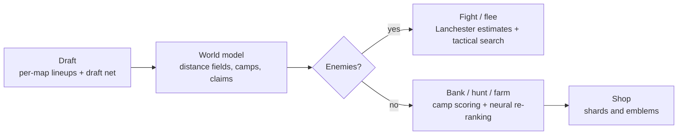

<div align="center">

# ☢️ DOOMSDAY

**Team DOOMSDAY's bot for Cambridge Battlecode 2026: a C++ → WebAssembly game AI, built and tuned over
three and a half weeks by a team of students and a fleet of AI coding agents.**


-lightgrey)

</div>

---

## At a glance

| | |
|---|---|
| **Competition** | [Cambridge Battlecode 2026](https://2026a.battlecode.co.uk) (CAMBC): bots play an online ladder, with no humans in the loop |
| **Duration** | 19 October – 11 November 2026, ending at the UK qualifier lock |
| **Ladder** | From **rank 87 to a peak of rank 41** (rating 1834 → 2206) |
| **Scale** | ~2,100 commits · 250+ bot builds · ~1,500 research reports · 700+ analysis and benchmark scripts |
| **Bot** | ~17k lines of C++ under a 100k-instruction-per-turn budget, with small quantised neural networks inside |
| **Team** | 6 contributors directing Claude Code, Codex/GPT and named agents across up to 5 machines |

## The challenge

Each side drafts 3–5 champions, then plays up to 2,000 rounds. Champions clear monster camps for gems and gold, buy
items, fight the other team, and race to **bank 1,000 gems** at an altar. A death hands the killer your whole bag.

Three things make it hard:

- **No shared vision**, and only **8 bytes** of team memory per turn.
- Every WebAssembly instruction costs **fuel**, and a turn gets 100,000. Run out and you lose the turn.
- The engine is **deterministic**: a do-nothing code change still moves fuel use and flips games.

→ [Full rules primer](docs/game.md)

## How the bot works

A hand-written heuristic core, with networks only where they earn their fuel:



- **Per-map intelligence:** the bot fingerprints each map on its first turn and loads a tuned draft and a vector of
  48 strategy knobs.
- **Neural re-ranking (nnq4):** a 16-bit network overrides the heuristic camp choice only when it is confident
  (a 2-logit margin), and refreshes in stages on spare fuel.
- **Coordination:** champions publish camp claims, sightings and respawn timers through the 8-byte shared memory.

→ [Architecture deep-dive](docs/architecture.md)

## The journey

| Phase | Dates | What happened |
|---|---|---|
| 0 · agent-36 | 19–21 Oct | First repo: a four-agent prompt pack, bots v34–v36 |
| 1 · Neural framework | 24 Oct | Behaviour cloning on **7.3M** top-team decisions. It learned nothing usable, so we pivoted to heuristics |
| 2 · Heuristic sprint | 25–26 Oct | v51 → v61 behind statistical release gates: island and stampede fixes, crew jobs, economy package. **Rank 87 → 54** |
| 3 · Per-map tuning | 27–28 Oct | Per-map drafts and knob tables (v65–v81), a proxy opponent of the top teams, a clean-slate rewrite (DOOMSDAY Zero) |
| 4 · Scale-out | 29 Oct – 2 Nov | Multi-machine campaigns over a git message board: map atlas and portfolio, gigabot, botx3. **v92** becomes the reference |
| 5 · Neural blend | 3–5 Nov | Agent 2's **nnq4** blend (54.6% vs v92 over 1,440 games), a recurrent PPO learner, engine 3.0.0 |
| 6 · Qualifier week | 7–11 Nov | Codex agentic loop v108–v112 → **peak rank 41**, then root-cause fixes v113–v138 up to the qualifier lock |

→ [Detailed timeline, with sources](docs/timeline.md)

## What we learned

1. **Compute is the opponent.** A behaviour-identical change in a hot loop lost 70–98 over 168 games.
2. **One build is one draw.** An "improved" RL checkpoint fell from 56% to 44.5% once its own scores were jittered.
3. **Self-play lies.** Local gains of +37 to +89 were about zero on the ladder. Only paired ladder duels predicted it.
4. **Losses are economic.** Production was the biggest deficit in 96 of 151 losses. +150 gold at round 100 meant an
   84.5% win rate.
5. **Networks work beside heuristics, not instead of them.**

→ [All findings, with the numbers](docs/findings.md)

## Repository map

```text
bots/          250+ builds by workstream: mainline (v48→v115e), x-series, gigabot, codex, botx3, rl-env, neural …
research/      Reports and measurements for every version and workstream (versions/, codex-live/, rl-env/, …)
tools/         Benchmarks (bench3, Bayesian and map-clustered comparison), replay decoding, ladder duels, map atlas
data/          Ladder snapshots, decoded loss samples, match manifests
maps/          The 86-map ladder pool, local benchmark sets, generated and maze maps
neural/        The neural framework: Python package, schemas, models, locked evaluation protocol
tests/         Python and C++ tests, fixtures, loss cases
sdk/           The official C++ SDK and CMake files
docs/          Primer, architecture, timeline, findings, team; history/ holds every original hand-over and prompt
archive/       Retired material: the agent-36 project, agent workspaces, continuation packages
```

## Team

**Rishik** (`R1shik123`, team lead) · **Om Dhande** (`Infosuii`) · **Ishan Patil** (`ishanp765`) ·
**Tamim Atiqur** · **Iniya** · **johndoe** (`johndoe123983`), working with Claude Code, Codex/GPT and Agents 2 and 4.

→ [Who did what, and where every old branch went](docs/workstreams.md)

## Using this repository

This is a **finished project**, and the platform has moved on to newer engines. It is kept as a record of the work, not
as a ready-to-run build. Expect to fix paths, because scripts still use the pre-cleanup layout.

- **Every former branch** is preserved as a tag `archive/<branch-name>`, for example `archive/build/z-plan`.
- **Large raw evidence** (game-dump zips, split archives) is in git history but not in the current tree. See
  [`archive/REMOVED_FROM_TREE.tsv`](archive/REMOVED_FROM_TREE.tsv).
- **Building a bot:** `cambc build bots/mainline/v92 --release --output v92.wasm` with the official `cambc` CLI.
