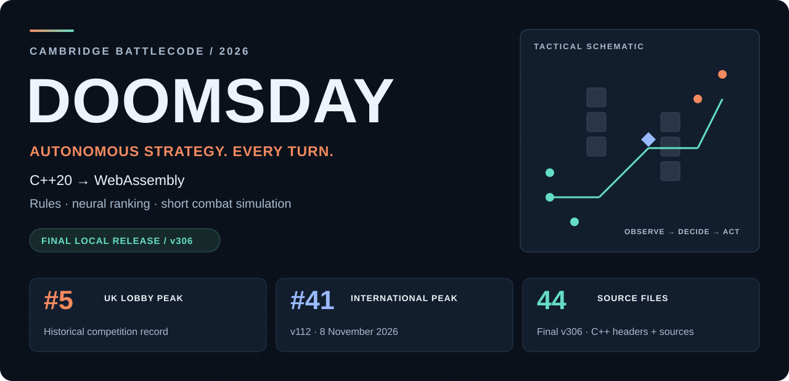
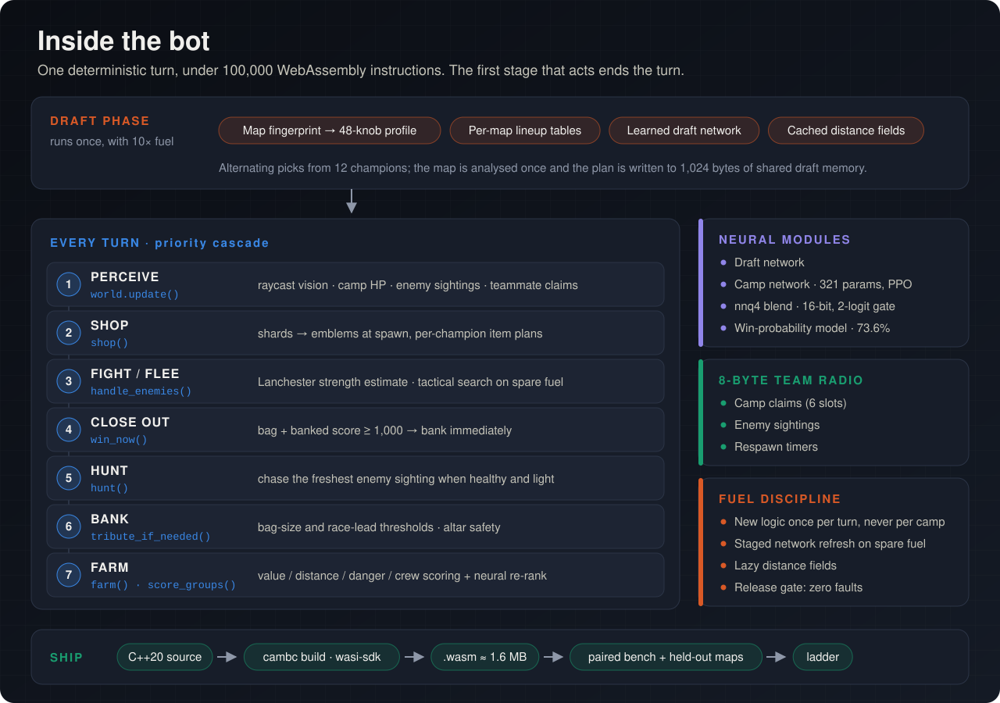
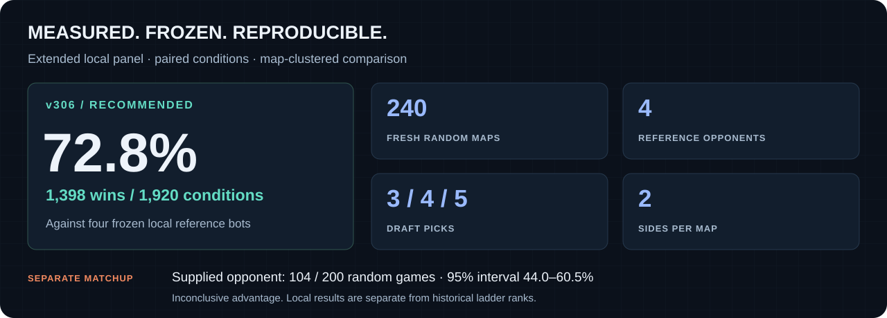
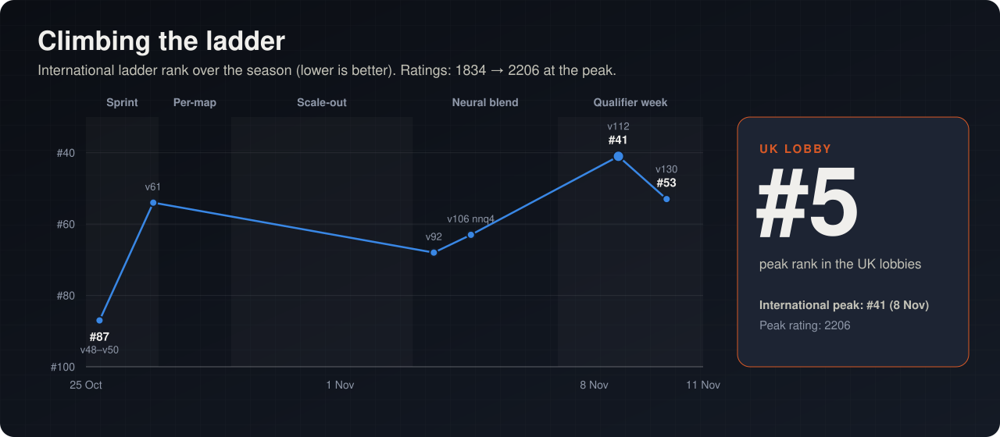

<p align="center">
  
</p>

<p align="center">
  <a href="docs/START-HERE.md"></a>
  <a href="research/doomsday-movement-20261110/releases/best-final-v306AltarPressureReach/compiled-bot.zip"></a>
  <a href="docs/RESULTS.md"></a>
</p>

<p align="center">
  <b>Draft a team. Build an economy. Take the right fight. Get the gems home.</b><br>
  An autonomous strategy bot built for Cambridge Battlecode, combining hand-written tactics,<br>
  neural camp ranking and short combat simulations under a strict instruction budget.
</p>

<p align="center">
  <a href="#the-project">Project</a> ·
  <a href="#inside-the-bot">Architecture</a> ·
  <a href="#measured-performance">Results</a> ·
  <a href="#engineering-the-edge">Engineering</a> ·
  <a href="#explore-the-repository">Source &amp; downloads</a> ·
  <a href="#the-team">Team</a>
</p>

---

## The project

Cambridge Battlecode asks a team of programs to play a complete strategy game without human input. Teams draft
champions, clear monster camps, earn gold, buy items and fight over resources. Carried gems only become score when
they reach an altar; a death can hand the entire bag to the opposition.

DOOMSDAY grew from an early policy prototype into a hybrid C++20 system compiled to WebAssembly. Its final
recommended local release is **v306AltarPressureReach**. The repository preserves the source, compiled artifacts,
experimental alternatives and the measurements behind that choice.

| Competition history | Final implementation | Evaluation |
|---|---|---|
| **#5 UK lobby peak** | **44 C++ source/header files** | **240 fresh random maps** in the extended panel |
| **#41 international peak** | **22,055 source lines**, including model tables | **1,398 / 1,920** v306 wins against four local references |
| Peaks recorded during the season | Rules, neural ranking and short simulation | Both sides; three draft sizes; variable altars |

The historical ladder peaks belong to earlier live builds, including v112 at international #41. The final local
benchmark is a separate result; it is not a ladder rating or a finals placement.

**Start with [the guided tour](docs/START-HERE.md), [the final source](bots/mainline/v306AltarPressureReach/src), or
[the compiled release](research/doomsday-movement-20261110/releases/best-final-v306AltarPressureReach/compiled-bot.zip).**

## Inside the bot

<p align="center">
  
</p>

Each champion maintains its own persistent state. A priority cascade decides what matters now; small shared
messages coordinate local teamwork.

| System | What makes it interesting |
|---|---|
| **World model & navigation** | Cached terrain, camp states and sightings; walking-distance fields; dashes, gap crossings and teleport shortcuts; recovery from blocked or unreachable jobs. |
| **Camp economy** | Reward per travel/fight/capture time, early gold emphasis, two-stop lookahead, local crew claims and useful side work during respawn downtime. |
| **Neural ranking** | A 500-feature entity network, cached encoders and 16-bit inference. Its camp preferences are blended with the hand scorer and checked for validity. |
| **Combat** | A short fight-versus-retreat simulation, ready-burst checks, ranged micro, attack resets and supported attacks against isolated targets. |
| **Team play** | Actual hitters and reachable firing tiles matter. Helpers can finish invested camp work, preserve one capture anchor or peel a pursuer off a loaded teammate. |
| **Banking** | Winning-bag priority, short safe deposits despite visible enemies, channel-risk checks, retry memory and timed interruption of enemy submissions. |
| **Draft** | Recognised-map lineups, map analysis and a separate neural scorer on eligible unfamiliar maps. |

The shipped configuration matters: the larger tactical action search, central economy director, direct neural
fight/run policy and several learned movement systems are retained as experiments but disabled. The
**short fight-versus-retreat simulator is active**. The bot does not train its weights during a match.

→ [Architecture overview](docs/architecture.md) ·
[Complete feature and decision audit](research/doomsday-movement-20261110/architecture-audit-v306-20261111/BOT-ARCHITECTURE.md) ·
[All 700 named source macros](research/doomsday-movement-20261110/architecture-audit-v306-20261111/CONFIGURATION-APPENDIX.md)

## Measured performance

<p align="center">
  
</p>

The final extended comparison kept the baseline when newer variants did not demonstrate an improvement.

| Frozen build | Fresh random pool | Published-map pool | Outcome |
|---|---:|---:|---|
| **v306 · AltarPressureReach** | **1,398 / 1,920 · 72.8%** | **276 / 420 · 65.7%** | Recommended release |
| v320 · CampChannelCore | 1,395 / 1,920 · 72.7% | 278 / 420 · 66.2% | Retry required |
| v348 · LethalFinishSafety | 1,374 / 1,920 · 71.6% | 270 / 420 · 64.3% | Retry required |

The fresh pool uses **240 new maps**, five terrain/reward families, three team sizes, four references and both
sides. Candidate gains were assessed with map-clustered intervals. These figures describe this local opponent
panel; synthetic map frequencies are not an estimate of the finals pool.

A separate supplied-opponent test was deliberately less conclusive: v306 won **104 / 200** fresh-random games
(52.0%; 95% map-cluster interval **44.0–60.5%**) and **45 / 60** published-map games. The random result does not
establish a reliable advantage. Major-objective maps remain a documented weakness.

**Zero native bot faults were recorded in the reported final comparison cohorts. Fuel exhaustion was tracked
separately and was not zero.**

→ [Results, scope and limitations](docs/RESULTS.md) ·
[Extended benchmark record](research/doomsday-movement-20261110/crew-next/long15-261110355-REPORT.md) ·
[Supplied-opponent analysis](research/doomsday-movement-20261110/crew-next/mediumzip-7d9b610b-261111401-REPORT.md)

<details>
<summary><b>Earlier ladder history</b></summary>

<p></p>

Earlier milestones include the v58 economy package, per-map draft tuning, the v106 neural camp blend and the v112
weight retune. These belong to different versions, opponents and evaluation conditions; they are not interchangeable
with the final v306 panel.

See the [dated timeline and sources](docs/timeline.md).

</details>

## Engineering the edge

**A turn is a budget.** The historical engine allowed 100,000 WebAssembly fuel per ordinary turn. Navigation,
combat and neural inference compete for that budget. DOOMSDAY uses capped searches, staged inference, cached
distance fields, SIMD and quantisation to keep optional work from consuming the rest of a turn.

**A teammate nearby is not necessarily a teammate who can hit.** Supported pressure checks attack readiness,
channel state and reachable firing tiles. Two allies cannot both be credited with the same free square. A healthy
capture anchor can stay on the reward while the others act.

**A plausible fix still needs evidence.** Experiments retain source identities, compiled hashes and paired
conditions. Replay diagnosis separates a strategic failure from a broken gate, missing input or fuel problem.
Promising failures remain eligible for focused repairs; a failed benchmark is not automatically a rejected idea.

**The archive is part of the result.** The final workstream preserves **19,710 source and research files** in a
deduplicated capsule with manifests and SHA-256 verification. Readable release sources, reports and the architecture
audit are also available directly in the tree.

→ [Findings across the project](docs/findings.md) ·
[Final development log](research/doomsday-movement-20261110/crew-next/ROUND3-DEVELOPMENT-20261110.md)

## Explore the repository

| Looking for… | Go here |
|---|---|
| A quick technical tour | [Start here](docs/START-HERE.md) |
| The recommended bot | [v306 source](bots/mainline/v306AltarPressureReach/src) · [compiled ZIP](research/doomsday-movement-20261110/releases/best-final-v306AltarPressureReach/compiled-bot.zip) · [source ZIP](research/doomsday-movement-20261110/releases/best-final-v306AltarPressureReach/bot.zip) |
| Every feature, including disabled systems | [Complete v306 audit](research/doomsday-movement-20261110/architecture-audit-v306-20261111/BOT-ARCHITECTURE.md) |
| Benchmarks and reproducibility | [Results guide](docs/RESULTS.md) · [release receipt](bots/mainline/v306AltarPressureReach/release-build.json) |
| Experimental bot families | [Bot catalogue](bots/README.md) |
| Research, learning and loss diagnosis | [Research index](research/README.md) |
| The game and its constraints | [Rules primer](docs/game.md) · [SDK](sdk) |
| Historical work and the team | [Timeline](docs/timeline.md) · [Workstreams](docs/workstreams.md) |
| The complete final workstream | [Archive guide and restore instructions](research/doomsday-movement-20261110/README.md) |

<details>
<summary><b>Repository layout</b></summary>

```text
bots/       Final v306/v320/v348 sources and historical bot families
research/   Final audit, releases, benchmark records and earlier investigations
docs/       Guided tour, architecture, results, game rules and project history
tools/      Evaluation, replay decoding, tuning and historical experiment tooling
neural/     Training framework, models and observation schemas
maps/       Preserved map pools and generated benchmark maps
data/       Ladder snapshots, analysis inputs and match manifests
tests/      Mechanic probes, regression cases and historical tests
sdk/        Preserved C++ SDK and build support
archive/    Retired workspaces, earlier handoffs and archival records
```

</details>

## The team

| **Om Dhande** | **Rishik** | **Ishan Patil** | **Iniya** |
|:---:|:---:|:---:|:---:|
| Team lead | Campaigns · RL environment | Fuel merge · live analysis | Neural blend research |
| [@Infosuii](https://github.com/Infosuii) | [@R1shik123](https://github.com/R1shik123) | [@ishanp765](https://github.com/ishanp765) | — |

→ [Workstreams and contributions](docs/workstreams.md)

---

<p align="center"><b>Built through experiments. Preserved with evidence.</b></p>

<p align="center"><sub>Competition research archive · October–November 2026<br>
Historical engine and SDK versions apply. Some older tools retain pre-reorganisation paths.<br>
See the guided tour for downloads, build context and reproducibility notes.</sub></p>
