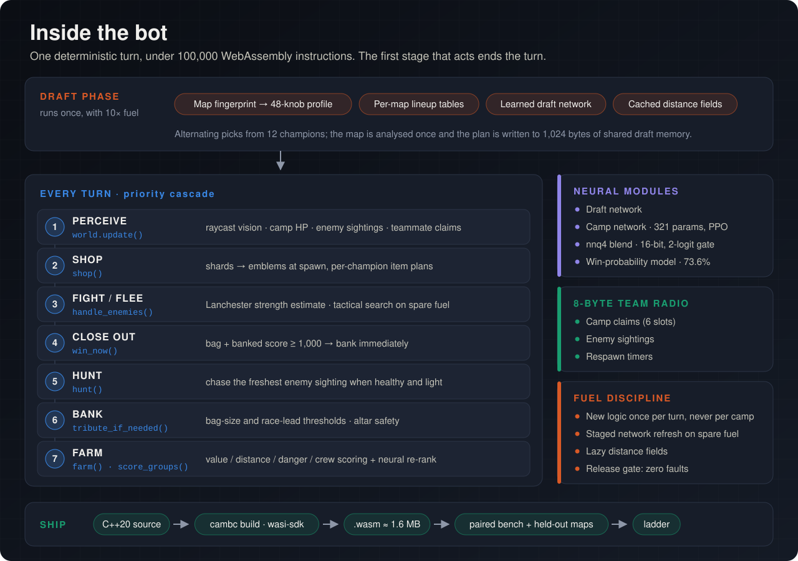

# How v306 works

DOOMSDAY's final recommended local release is a **hybrid C++20 bot compiled to WebAssembly**. Each champion runs
an independent persistent controller. Rules handle most actions, a neural network helps rank camps, a separate
neural scorer can assist eligible drafts, and a short simulator compares fighting with retreating.

## The turn pipeline

Observe and update memory → shop/support → safe immediate deposit → enemy contact → urgent banking → home/team
support → hunt/bank/farm → optional background work.

Earlier branches can consume the decision before later branches run. Legal action combinations still allow
attacks, movement and compatible spells within a turn; it is not simply one API call per turn.

| Area | Source | Responsibility |
|---|---|---|
| Main cascade | [bot.cpp](../bots/mainline/v306AltarPressureReach/src/bot.cpp) | `play_turn`; precedence, channel handling and action dispatch |
| Persistent world | [world.cpp](../bots/mainline/v306AltarPressureReach/src/world.cpp) | Camps, terrain, sightings, bushes and distance fields |
| Navigation | `follow_field`, `walk_toward`, `retreat_from` | Walking paths, dashes, gap crossings, fallback search and stall recovery |
| Economy | `score_groups`, `route_search`, `farm` | Value per time, local claims, two-stop lookahead and downtime jobs |
| Fight/run decision | [tsearch.cpp](../bots/mainline/v306AltarPressureReach/src/tsearch.cpp) | Short kit-aware simulation, with budget and modelling safeguards |
| Combat execution | `handle_enemies`, `caster_micro` | Targeting, kiting, supported pressure, spell ordering and retreat |
| Capture protection | [pressure.cpp](../bots/mainline/v306AltarPressureReach/src/pressure.cpp) | One capture anchor, safe footwork and supported local contest |
| Banking | `tribute_if_needed`, `bank_visible_window` | Thresholds, winning bags, altar access, short safe channels and retries |
| Tribute denial | [deny.cpp](../bots/mainline/v306AltarPressureReach/src/deny.cpp) | Kill/interrupt timing against a channeling opponent |
| Items | `build_for`, `shop` | Champion-aware item milestones, consumables and completion tracking |
| Coordination | `write_claim`, `read_sighting` | Compact camp claims, sightings and respawn messages |
| Draft | [draft.cpp](../bots/mainline/v306AltarPressureReach/src/draft.cpp) | Tables, map analysis, conditional neural draft and fallback rosters |

## The neural boundary

The main network has 500 feature slots: global state, self, five allies, eight enemies, ten candidate camps and four
altars. Entity encoders produce 16-value representations; pooling forms a 160-value summary followed by two
64-unit layers. The model contains multiple output families, but **camp ranking is its main deployed influence**.

The hand scorer remains part of the choice. Neural suggestions pass validity, freshness, margin and partnership
checks. Movement, shopping, banking and combat are not all directly controlled by that network.

Cached encoders, staged live/lazy updates, 16-bit quantisation and WebAssembly SIMD reduce inference cost.
Weights remain fixed during a match. A changing observation cache is not online training.

## Team play without a central commander

Shared memory holds compact claims and one small sighting/event payload. Local rules turn those messages and
visible teammates into crews, capture ownership, buddy farming, supported pressure and carrier protection.

Support is checked against reach, readiness and safe firing squares. A channeling ally cannot be counted as an
immediate hitter. Completed captures can retain one anchor while helpers leave. The current configuration also
overrides selected camp staffing to one, an important limit on the wider crew machinery.

## Configuration is part of the architecture

Several tempting interpretations of the source are wrong:

| What appears in the code | What v306 actually does |
|---|---|
| Full tactical search switch is off | The independent short fight/run simulator is still on |
| Common settings say neural draft is off | draft.cpp overrides the setting and enables an eligible path |
| Multiple item presets are enabled | The active item plan returns before the older plans |
| Network has banking and action heads | The selected deployment leaves these mostly dormant |
| Central economy director exists | It is switched off |
| Ward-drop switch is off | Independent reactive ward uses remain active |

This is why the full audit records **700 named macros**, translation-unit differences and runtime gates, rather
than treating every flag as an independent active feature.

## Fuel discipline and its limits

The historical ordinary-turn budget was 100,000 WebAssembly fuel. Optional work is admitted only with a reserve:
capped navigation search, bounded tactical playouts, incremental fields and staged neural refresh all compete for
time. A quiet turn may prepare work that a later combat turn reuses.

These mechanisms reduce exhaustion; they do not eliminate it. The final benchmark distinguishes zero native bot
faults from nonzero exhausted-fuel events. See [results](RESULTS.md).

## Continue deeper

- [Full feature audit, including disabled systems](../research/doomsday-movement-20261110/architecture-audit-v306-20261111/BOT-ARCHITECTURE.md)
- [Configuration appendix](../research/doomsday-movement-20261110/architecture-audit-v306-20261111/CONFIGURATION-APPENDIX.md)
- [Runtime knobs](../research/doomsday-movement-20261110/architecture-audit-v306-20261111/RUNTIME-KNOBS.md)
- [Source method index](../research/doomsday-movement-20261110/architecture-audit-v306-20261111/SOURCE-METHOD-INDEX.md)
- [Historical neural blend research](../research/neural/nnq4-blend/README.md)
- [Experimental families](../bots/README.md)

v320 adds camp-aware channel safety; v348 also adds a narrow lethal camp-finishing spell exception. They are
preserved experiments, and neither displaced v306 in the final benchmark. The larger research archive also retains
earlier team-economy, policy-learning, map-portfolio and clean-slate systems; they are not all active in this release.
