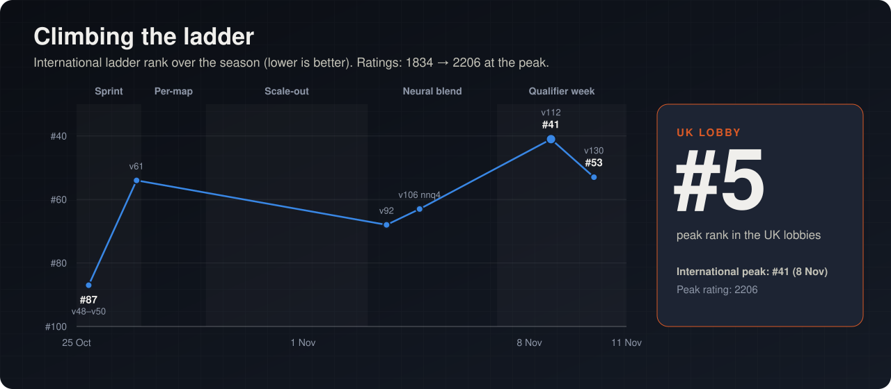

# Project timeline (19 Oct – 11 Nov 2026)

Three and a half weeks, about 2,100 commits and more than 250 bot builds. The team's peak was **5th in the UK lobby**.
The ranks below are from the **international** ladder. All times are UTC. The source for each phase
is linked so every claim can be checked.

## International ladder standing

The UK lobby ranks UK teams separately; our peak there was **5th**.

| When | International rank | Rating | Live bot | Source |
|---|---:|---:|---|---|
| 25 Oct (first snapshot) | 87 | 1834 | v48–v50 lineage | [handoff.md](history/handoffs/handoff.md) |
| 26 Oct 20:30 | 54 | 1939 | v61 (platform 60) | [HANDOFF_V61.md](history/handoffs/HANDOFF_V61.md) |
| 3 Nov 14:00 | 68 | 2016 | v92 / x3 variants | [HANDOVER_LEAD.md](history/handoffs/HANDOVER_LEAD.md) |
| 4 Nov 14:30 | 63 | 2041 | v106 (nnq4) submitted | [nnq4-blend](../research/neural/nnq4-blend/README.md) |
| **8 Nov** | **41** | **2206** | **v112** | [V112_LADDER_DIAGNOSIS.md](../research/rl-env/rl_env_1104/candidates/V112_LADDER_DIAGNOSIS.md) |
| 9 Nov 23:52 | 53 | 2157 | v130 | [HANDOVER_2026-11-09.md](../research/rl-env/rl_env_1104/HANDOVER_2026-11-09.md) |

Ratings across the whole ladder rose over the season (the mean opponent rating went from 2064 to 2139 during v108–v112
alone). Rank is the fairer measure of progress.

## Phase 0: the prototype (19–21 Oct)

The first repository. Parallel workstreams built bots v34 and v36 and tuned settings on engine 1.0.1. Their changes
were combined into one switchable candidate, and v36 was kept as the base bot.
→ [`archive/prototype-v36`](../archive/prototype-v36)

## Phase 1: a fully neural bot (24 Oct)

The "neural framework": parallel workstreams, built in "waves", aiming to give a network direct control of
gameplay. Built in this phase:

- an official-engine replay decoder;
- a behaviour-cloning pipeline trained on **7.3M decisions from top teams' replays**;
- versioned observation schemas;
- a locked evaluation protocol.

**Result:** the policy learned nothing usable in real games: 0 gems, and 0–12 against the heuristic baseline. We
pivoted back to the heuristic bot and kept the tooling. → [`neural/`](../neural), [`research/neural/early`](../research/neural/early)

## Phase 2: the heuristic ladder sprint (25–26 Oct)

Many versions in a day and a half, each gated by a paired bench across 28 development maps × 2 sides × several seeds,
with 12 held-out maps:

| Version | Change | Measured |
|---|---|---|
| v51 | Moated-island fix: champions froze behind two-tile hole moats | big_world 0/26 on the ladder before the fix |
| v52 | Sole-gem-camp rule | stampede 0/28 on the ladder → 6–0 locally |
| v54 | Crew jobs, item milestones, lead lock, teleport shortcuts | +149 gems a game vs v53 |
| v55 | Completed camp missions, Heart of Ruin farming strikes | +106 vs v54 |
| v57 | Contest the middle | +122 vs v55, +85 on fresh holdout maps |
| v58 | Economy package on the Sprint 3 rules (engine 2.0.0) | 430/672, +153 vs v57; submitted as platform 57 |
| v59–v61 | Stat stacks, retreat when outnumbered, hold the spawn | from a review of v58's first 320 ladder games |

→ [`research/versions`](../research/versions), [`bots/mainline`](../bots/mainline)

## Phase 3: per-map tuning and a clean-slate rewrite (27–28 Oct)

- **v65–v81:** per-map draft tables (`V70_DRAFT_TABLE`), per-map knob profiles over 48 runtime knobs, siege and idle
  fixes found by a replay idle audit, and a team-fight system (v79).
- **Paired ladder duels** against the top 12 teams showed that local self-play gains often did not carry over. For
  example, v75 was −91 ± 54 against v74 on the ladder. **v74** (platform 68) stayed live.
- **A proxy opponent** (`bots/opponents/proxy`) imitating the top teams, so local tests stopped measuring only against
  our own lineage.
- **DOOMSDAY Zero** (from 28 Oct): a clean-slate C++20 bot with no old code.
  → [`bots/doomsday-zero`](../bots/doomsday-zero), [`research/doomsday-zero`](../research/doomsday-zero)

## Phase 4: scale-out across machines (29 Oct – 2 Nov)

Several machines ran campaigns in parallel: a PC, `g3`, an RTX 5060, an RTX 5070 Ti and `gmax`. They coordinated
through a git-based **message board** with jobs, leases and heartbeats
([`docs/history/team-comms`](history/team-comms)).

- **x-series:** a map atlas computed by the bot itself, map categories and a strategy portfolio (`x1`, `x3`, `x3mf`,
  `x3ctr`, `pf0`–`pf13`).
- **gigabot (gx):** about 100 single-mechanism increments, each with a matched control.
- **botx3:** team-economy coordination, eleven versions.
- **v92** became the reference bot (platform 75 / 80) on 2 Nov.

## Phase 5: neural blend and RL (3–5 Nov)

- **The nnq4 blend:** a 16-bit student network blended into v92's camp choice. It scored 54.6% vs v92 over 1,440
  games, with official maps over 60 tiles wide going from 37% to about 58% after a distance-field fix. It was submitted
  as **v106**. An RL checkpoint that looked better turned out to be noise once the bot's own scores were jittered.
- **A recurrent PPO learner** and belief model ([`research/rl-env`](../research/rl-env)).
- **5 Nov:** the platform moved to **engine 3.0.0 / CLI 5.0.0**.

## Phase 6: the live line and qualifier week (7–11 Nov)

- **v108–v112** (Om's live line): an automated improvement loop with mechanics fixes plus evolution-strategy-retuned network weights. **v112 went
  live on 8 Nov and took us to international #41.**
- **v113** fuel fix (Om), **v114/v116** early shop and a 16-map profile table (Rishik), **v115** fuel merge (Ishan),
  **v117** spawn-heal fix.
- **v118 root-cause cycle:** home-monolith siege (median first home capture from round 1,353 to round 417) and an
  Islands navigation stall fix (7/18 → 15/18). → [`research/live-line`](../research/live-line)
- **v119–v130:** a rapid series of pre-registered candidates on 9 Nov.
- **10 Nov:** **v137** = v135 + "shop while waiting" (+149 over 2,064 paired games vs v130), then **v138** with a
  6-map knob table, blocked-tile memory and tribute alerts. The **UK qualifier lock** was 23:59 GMT that night.
- **10–11 Nov, final local movement/crew workstream:** v306 adds supported isolated-target pressure and safer nearby banking. v320 and v348 retain further camp/channel safety experiments.
- **11 Nov, extended comparison:** v306 remains recommended at 1,398/1,920 primary random-pool wins; neither newer candidate demonstrates a primary-pool gain. A separate supplied-opponent matchup is inconclusive on random maps.
- **11 Nov, source audit:** 44 source/header files, 700 named macros and the full decision flow are documented, including disabled or shadowed systems.
- **12 Nov, preservation:** the final sources, releases and benchmark records are added to this repository with a verified capsule preserving 19,710 source/research files.

→ [Final workstream](../research/doomsday-movement-20261110/README.md) · [Results and scope](RESULTS.md)
