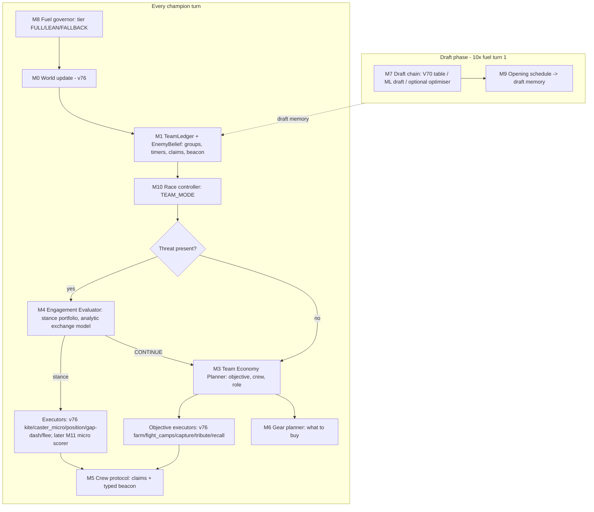

# MASTER ARCHITECTURE: DOOMSDAY "OCC" (Objective–Crew–Combat) controller

**Status.** This is the recommended design, not implemented. It stands alone: the mathematics is in
ALGORITHM_SPECIFICATIONS.md, interfaces in DATA_STRUCTURES_AND_INTERFACES.md, and budgets in FUEL_AND_PERFORMANCE.md.

## 0. Design thesis

The game is a **race to 1000 banked gems**. Champions convert *time* into gems and gold through objectives. Gold
converts into power, which raises future conversion rates and fight outcomes. Deaths destroy time, bags and tempo, and
feed the enemy.

Our losses against strong teams come from a coupled loop (CURRENT_BOT_AUDIT §5, TOP_TEAM §3):
- slower openings and gear
- worse fights and more deaths
- lower retention of income under contest
- unconverted bags

OCC replaces v76's per-champion greedy farming and stacked fight overrides with one value scale, **gem-equivalents
(GE)**, and an explicit hierarchy in which every decision has one owner. It keeps v76's proven engine-facing code and
executors, so every module can be switched off to recover v76 exactly.

## 1. Global objective and value scale

- **Objective.** Maximise P(win). Because the game is a race, the operational proxy is:
  - **maximise expected banked-gem margin at the end**
  - subject to the race state, which switches the objective to "reduce our time-to-1000 / increase theirs" when
    either team is close (§6).
- **Gem-equivalents.** Every decision compares alternatives in GE:
  - gems are worth 1
  - gold is worth λ_gold(t)
  - a death costs `bag + λ_gold(t)·kill_gold + λ_tempo·T_respawn·ρ̄(t)`
  - an objective's progress is worth its reward × probability of completion

  λ_gold(t) and ρ̄(t) are time-dependent and calibrated (ALGO §2). No arbitrary weights: each coefficient is either
  derived from the rules or fitted by the stated procedure.

## 2. Layers and ownership



| Layer | Modules | Horizon | Final authority over |
|---|---|---|---|
| Strategic | M10 Race controller; M3 TEP (team objective assignment); M6 Gear planner; M7 Draft; M9 Opening | 8–120 rounds | TEAM_MODE; each champion's objective, crew and role; purchases; lineup |
| Coordination | M5 Crew protocol; M1 TeamLedger | 1–8 rounds | Shared word content; crew membership; leader stance |
| Tactical | M4 EE; executors (v76, or M11 later) | 1–4 rounds | Fight, hold, kite, disengage or retreat; concrete move/attack/cast |
| Infrastructure | M0 World (v76), M8 Governor | per turn | State, fuel tiers, fallbacks |

**Decision authority table (no hidden overrides):**

| Decision | Owner | Who may pre-empt it, and when |
|---|---|---|
| Continue or cancel a channel (recall, tribute) | Channel guard (v76 + M1 fix) | EE RETREAT only, if P(die next round) > 0.5 |
| Stance when a threat is present | **EE** | Nobody. EE contains the personal-danger override |
| Objective, crew, role | **TEP** | EE while its stance ≠ CONTINUE; the race controller's TEAM_MODE (an input to TEP, not an override) |
| Bank now | TEP BANK objective (hazard rule) | Race controller (forces bank in ENDGAME_RACE); EE delays it while a threat sits on the path |
| Purchases | Gear planner | — |
| Shared word | Crew protocol | Pre-emption order fixed in DATA §4 |
| Lineup | Draft chain | — |
| Legality of actions | Executors and SDK | — |

## 3. Turn lifecycle (each champion, each turn)

```
 0. gov.start()                                   // tier from fuel_remaining(); hard reserve 12k
 1. world.update()                                // v76; dead champion: only shop (step 9) and publish
 2. ledger.sync(shared_word, world)               // decode claims + beacon; timers; EnemyBelief decay
 3. race.update(ledger)                           // TEAM_MODE ∈ {FARM, CONTEST(g), DEFEND_BANK, ENDGAME_RACE, REGROUP}
 4. if channel_active: channel_guard()            // continue unless EE says RETREAT with P_die_next>0.5; M1 rule
 5. threat = threat_model(world, ledger)          // any enemy ≤10, or hidden pressure at pos > θ_hidden
 6. if threat: d = EE.decide(scene, assignment, crew_stance, gov)
        if d.stance != CONTINUE: execute(d) ; publish(); return
 7. a = TEP.role(me, ledger, model, claims, race.mode, gov)   // cached between replans; contract check every turn
 8. execute objective executor for a.role (CLEAR/CAPTURE/MOVE_TO/BANK/SHOP/ESCORT/DEFEND/CLUSTER_RUN)
 9. if on spawn or dead: gear.buy(gov)              // M6
10. opportunistic (tier FULL only): ward on recharge (S12), altar lock (S7/S9), pre-lock
11. publish(claims, beacon)                        // M5
```

**Initialisation.**
- **First play turn (2× fuel):**
  - read engine metadata: champions, items, camps, settings
  - decode draft memory: opening schedule, map summary
  - start incremental distance-field building (v76)
  - initialise the ledger from map groups
  - compute the static group classes (damage-bound vs capture-bound) and the altar list
- **Draft turns:** the draft chain; the opening schedule on the final pick turn.

## 4. Role state machine (per champion; TEP sets it, executors run it)

```mermaid
stateDiagram-v2
  [*] --> MOVE_TO: assignment
  MOVE_TO --> CLEAR: arrived & group alive
  MOVE_TO --> CAPTURE: arrived & group in REWARD
  MOVE_TO --> WAIT_RESPAWN: arrived early (<= 6 rounds)
  WAIT_RESPAWN --> CLEAR: respawned
  CLEAR --> CAPTURE: last camp dead & I am capturer
  CLEAR --> RELEASED: last camp dead & not capturer
  CAPTURE --> RELEASED: reward received
  MOVE_TO --> RELEASED: contract fail (6 rounds no progress) / objective invalid
  RELEASED --> [*]: replan
  state BANK_TRIP { [*] --> TO_ALTAR --> TRIBUTING --> [*] }
  state SHOP_TRIP { [*] --> RECALLING --> ON_SPAWN --> [*] }
```

**Cancellation rules:**
- An assignment ends on completion, invalidation (group observed in a different state than expected), contract
  failure, death, or a TEP replan that beats it by ≥15% (hysteresis).
- EE stances other than CONTINUE suspend the role without cancelling it. The role resumes when the stance returns
  CONTINUE, unless the contract has failed meanwhile.
- A BANK_TRIP is cancelled only by EE RETREAT or a better altar (Δ ≥ 3 rounds).
- A tribute already started is never cancelled except by EE RETREAT with P_die_next > 0.5. Damage does not stop a
  tribute, so staying is often right.

**Emergency overrides (in order):**
1. Fuel tier FALLBACK: run the v76 path for this turn.
2. Exception in any OCC module: v76 path for this turn, with an error counter. After 3 errors the module is disabled
   for the rest of the game.
3. Personal danger inside EE.

## 5. Coordination protocol (summary; DATA §4 is normative)

- **Shared word (64 bits).**
  - 6 claim slots × 7 bits (unchanged from v76: group id, on-site code, idle, dead).
  - A 22-bit typed beacon: 2 type bits + 20 payload bits. The types are SIGHTING, CAMP_EVENT, CREW_STANCE and
    TEAM_MODE, with fixed pre-emption and freshness.
- **Crews.** Champions whose claims share a group, or whose objectives lie within 8 tiles, form a crew. The leader is
  the lowest slot in the crew. `set_priority` makes slot order equal to action order, so the leader's stance is
  fresh within the same round for later movers.
- **Missing or stale communication.**
  - A claim older than 3 rounds with no on-site code is treated as "probably still assigned", with weight 0.5 in
    TEP's residual problem.
  - A beacon past its freshness is ignored.
  - A missing leader stance means the member decides alone, using the pessimistic weight.
- **Representational sufficiency** (proof in DATA §4.3): every coordination fact the design needs fits the word:
  objective ownership (claims), on-site status, enemy sighting, camp events, crew stance and team mode, given
  time-multiplexing with priorities and freshness windows.

## 6. Strategic phases and the race controller

TEAM_MODE is computed by every champion identically from shared or deterministic information: banked scores via SDK,
the round, the ledger, and visible bags. It is published in the beacon only when it changes.

| Mode | Trigger | Effect on TEP / EE |
|---|---|---|
| FARM (default) | — | Normal rates |
| CONTEST(g) | A high-value group g (top 20% of reward) under enemy pressure, with our crew strength ratio ≥ 1.2 | TEP bonus for crews on g; EE HOLD value up |
| DEFEND_BANK | An ally carrier with bag ≥ 60 on an altar path under pressure | ESCORT role for the nearest member |
| ENDGAME_RACE | `T_us_to_1000 ≤ 150` or `T_them_to_1000 ≤ 150` | BANK forced at bag ≥ 1; altar locks on enemy carriers; EE pessimistic for carriers |
| REGROUP | 2+ allies dead or average HP < 40% while the enemy is ahead | Solo objectives only near spawn; no CONTEST |

Phase dependence is continuous through λ_gold(t), not discrete: gold is worth more early. This is the MOBA
"phase layer" idea [B8] in closed form.

## 7. Economy (summary; ALGO §3–4, §7)

- **Objectives:**
  - damage-bound camp groups
  - capture-bound clusters (CLUSTER_RUN)
  - respawn arrivals (MOVE_TO with a time window)
  - BANK
  - SHOP
  - ESCORT / DEFEND (from TEAM_MODE)
- **Rates.** `ρ(C,g) = P_ok(C,g) · Reward_GE / champion-rounds`. The validated ObjModel gives travel, clear, damage,
  capture time (3 with a Capture emblem) and reward (Prospector on clusters, Vesper and Treasure on gold).
- **Allocation.** A sequential auction through claims, with crews of size 1–3 (rarely 4), regret-2 and one-step
  follow-up. Clusters are single-champion by rule.
- **Contracts.** Progress every ≤6 rounds, or release and avoid the group for 15 rounds (40 on a second failure).
- **Banking.** The burglar-problem cutoff, bank-on-route, Marcella preference, altar choice by pressure.
- **Gear.** Marginal ΔGE per gold over the remaining horizon, with emblem completion and role-specific value.

## 8. Combat (summary; ALGO §5)

- **Stance portfolio:** FIGHT(t1), FIGHT(t2), HOLD(o), KITE(t), DISENGAGE, RETREAT, CONTINUE.
- **Evaluation.** A 4-round discrete focused-fire attrition model with join times, bursts and stuns. Optimistic and
  pessimistic variants are mixed by π. The result is valued in GE, including objective progress and tempo.
- **Commitment.** Hysteresis margin `m = 0.15·DeathCost(me)`; crew stance adoption; no trickle-in.
- **Free-action rule.** Never leave a legal, useful hit unused when the stance doesn't need the allowance.
- **Execution.** v76 executors; optional M11 micro scorer if it beats them on scenario tests.
- **Bounded.** ≤12k fuel; FALLBACK to v76 `handle_enemies`.

## 9. Opponent modelling (ALGO §9)

- **EnemyBelief.** Last-seen position, HP, bag, items, `dead_until`, and channel age (to unmask perma-recall).
- **Symmetry prior.** Maps are fully known. The enemy's likely early objectives are the mirror of ours, which seeds
  pressure estimates before the first sighting.
- **Style classification at R100** (optional, gated): perma-recall share, contact rate, middle presence. It selects
  one of ≤3 parameter sets.
- **Fallback** when observations are insufficient: default parameters and the symmetric prior.

## 10. Memory persistence

| Store | Lifetime | Content |
|---|---|---|
| Per-champion statics (wasm memory) | game | Ledger, EnemyBelief, assignment, stance memory, caches, error counters |
| Shared word | game, rewritten each turn | Claims and typed beacon |
| Draft memory | written in draft; read-only after | Brain header (8 B); opening schedule (≤32 B); map summary (≤32 B) |

## 11. Fallback system

- **Per-module flag** (compile time). All zeros gives a Wasm byte-identical to v76.
- **Per-turn fuel tiers** (runtime). FALLBACK uses v76 paths.
- **Per-module error counters** (runtime). A module disables itself after 3 exceptions.
- **Release fallback candidate "v76s".** v76 + M1 fix + robust targeting, with all OCC modules off.

## 12. Migration from v76 (strangler pattern)

1. **Stage M-1.** `bots/v86` = a copy of `bots/v76/src` with empty OCC modules and flags at 0. Byte identity
   proven. The frozen `bots/v76` is never edited.
2. **Stage M-2.** Fixes (M1, robust targeting), then governor, ledger and race controller in shadow.
3. **Stage M-3.** TEP shadow (ObjModel validated first), then TEP owns farming (replacing `score_groups` and
   campnet), then BANK, SHOP and CLUSTER_RUN.
4. **Stage M-4.** EE shadow, then verdict-only (v76 execution), then stances, then crew stance.
5. **Stage M-5.** Gear planner; opening schedule (optional).
6. **Stage M-6.** League re-tuning of OCC scalars and the per-map lineup table on the final controller (D process).

Each stage has an independent gate (VALIDATION_PLAN.md) and can be shipped or reverted without touching the others.
