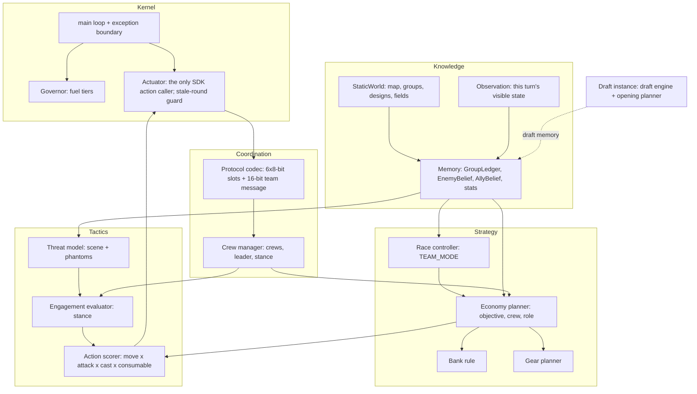

# MASTER ARCHITECTURE: DOOMSDAY Zero ("DZ"), a clean-slate algorithmic bot

**Status.** Design only; not implemented. Implementation starts on user approval.

**Constraint from the user.** DZ uses **no code from any previous DOOMSDAY bot** (`bots/*`, `references/*`). It is
built only on:
- the official SDK (`sdk/cpp/cambc.h`) and the C++ standard library
- the official CLI and CMake build
- repository *research* (findings, measurements and data) as design inputs
- repository *evaluation tools* (runners, replay decoders, statistics) for testing; these are not bot code

Previous bots appear only as **benchmark opponents**.

Companion documents:
- mechanics: GAME_MECHANICS_AND_WIN_CONDITIONS.md
- SDK semantics: SDK_AND_ENGINE_INTERFACE.md
- formulas: ALGORITHM_SPECIFICATIONS.md
- structs: DATA_STRUCTURES_AND_INTERFACES.md
- budgets: FUEL_AND_PERFORMANCE.md

## 0. Thesis

The game is a **race to 1000 banked gems**. Each champion converts time into gems and gold through objectives. Gold
converts into power, which raises future conversion and fight odds. Deaths destroy time, bags and tempo, and feed the
enemy.

Strong opponents beat our previous bots through a coupled loop:
- a faster opening and earlier gear (Intercontinental Fish: 483 vs 278 gold at R100)
- fewer deaths (2–5 vs 9–15 per game)
- higher retention under contest (93–96% vs 62–66%)
- better conversion (88–95% vs 56–86%)

Both economy and fights diverge by R100.

DZ is designed around that loop from the start:
- **one value scale**: gem-equivalents (GE), with time-varying gold value and death cost
- **one owner per decision**
- **team-level objectives** with crews
- **an objective-aware engagement evaluator**
- **a single scored action layer** for every concrete action
- **a kernel** that makes fuel exhaustion, stale state, exceptions and engine updates non-events

## 1. Layered structure



| Layer | Modules | Horizon | Final authority over |
|---|---|---|---|
| Kernel | K0 main, K1 Governor, K2 Actuator | one turn | Whether any module runs (fuel); whether an action is issued (stale-round and legality guard) |
| Knowledge | N1 StaticWorld, N2 Observation, N3 Memory | game | What the bot believes |
| Coordination | C1 Protocol, C2 Crews | 1–8 rounds | Shared-word contents; crew membership; crew stance |
| Strategy | S1 Race, S2 Economy (S3 Bank inside), S4 Gear, S5 Draft + Opening (draft instance) | 8–150 rounds | TEAM_MODE; objective, crew and role; purchases; lineup |
| Tactics | T1 Threat, T2 EE, T3 Action scorer | 1–4 rounds | Stance; the concrete move, attack, cast, consumable and ward of this turn |

## 2. Decision authority (no hidden overrides)

| Decision | Owner | May pre-empt it |
|---|---|---|
| Run or skip any module this turn | Governor | — |
| Issue an action | Actuator (refuses stale or illegal) | — |
| Continue or cancel own channel (recall, tribute, teleport) | EE (as part of stance) | — |
| Stance when a threat is present | **EE** | Nobody; EE contains the personal-danger override |
| Objective, crew, role | **Economy planner** | EE, only while its stance is not CONTINUE; TEAM_MODE is an *input*, not an override |
| Bank now | Bank rule (inside the economy planner) | Race controller forces it in ENDGAME_RACE; EE delays it while a threat sits on the path |
| Purchases | Gear planner | — |
| Ward and lock placement | Action scorer (opportunistic slot), with targets from the planner | — |
| Concrete per-turn actions | **Action scorer** | — |
| Shared word | Protocol (fixed pre-emption order) | — |
| Lineup and opening plan | Draft instance | — |

## 3. Kernel (the part that guarantees "no surprises")

```
int main():
  if is_draft(): DraftEngine::run(); // loops: compute, pick(), end_turn()
  Boot::init()          // first play turn (200k): read constants/designs/items/camp groups, fingerprint (CT-27),
                        // decode draft memory, schedule field builds, init ledger; any failure -> SafeMode flags
  for (;;):
    TurnContext tc = begin_turn()          // round = round_number(); fuel0 = fuel_remaining(); tier = Governor
    try   { Brain::turn(tc) }              // every module checks tc.round == round_number() before acting
    catch (...) { Errors::record(); SafeMode::turn(tc) wrapped in its own try }   // never escape main
    end_turn()
```

- **Stale-decision guard.** Fuel exhaustion suspends execution and resumes next turn mid-code, with stale locals.
  - The **Actuator** compares `round_number()` with `tc.round` before every SDK action. On a mismatch it refuses,
    throws an internal `StaleTurn`, and the turn restarts at the top with fresh observation.
  - Planner caches carry the round they were computed in, and are invalidated if they are older than allowed.
- **Exception boundary.** All SDK calls that can throw (`cambc::error`) are wrapped. Per-module error counters
  disable a module after 3 failures, and its work falls to **SafeMode**.
- **SafeMode** is a minimal, always-available behaviour, written on Day 2 as the walking skeleton and kept forever:
  - flee threats
  - farm the nearest safe group, solo
  - capture and bank at the nearest altar when the bag ≥ 30
  - shop a fixed build

  It runs in the FALLBACK fuel tier and after module failures.
- **Engine fingerprint** (CT-27). Startup hashes the constants, designs and items. On mismatch with the compiled
  reference, the bot still runs, because every value is runtime-read. The diagnostic output flags it so the
  conformance suite is re-run.

## 4. Turn lifecycle (champion instance)

```
 0. tc = begin_turn()                                      // round, fuel, tier
 1. obs = Observation::read(tc)                            // self, visible units/camps/groups/wards/locks/teleports
 2. mem.update(obs, Protocol::decode(shared_word))         // ledger timers, beliefs, ally claims, team message
 3. if self dead: Gear::shop_if_dead(); Protocol::publish(DEAD); return
 4. mode = Race::update(mem)                               // TEAM_MODE
 5. scene = Threat::build(obs, mem)                        // enemies ≤10, phantoms, awake camps
 6. if scene.threat: d = EE::decide(scene, assignment, crew_stance, tc)   // stance incl. channel decisions
    else d = CONTINUE
 7. if d == CONTINUE: assignment = Economy::role(me, mem, mode, tc)       // cached; contract check every turn
 8. plan = ActionScorer::choose(d, assignment, scene, obs, tc)            // move/attack/cast/consumable/ward/channel
 9. Actuator::execute(plan)                                // ordered: e.g. attack then move (melee), cast rules
10. if on spawn: Gear::buy(tc)                             // spawn shopping happens before leaving
11. Protocol::publish(slot record, team message)          // one read-modify-write
```

**Initialisation order on the first play turn** (200k budget):
1. Read engine settings, champion designs, items, consumables and camp designs; fingerprint them.
2. Map: walls, bushes, holes, altars, spawn regions, symmetry.
3. Camp groups: members, types, spawn tiles, rewards, respawn timers. Classify each as damage-bound or capture-bound;
   assign a region (own, mid, enemy) by spawn-distance ratio.
4. Distance fields:
   - field to own spawn region, then to each altar's adjacency ring
   - fields to the 25 groups nearest own spawn
   - the rest scheduled incrementally (Governor-budgeted)
5. Decode draft memory: lineup intent, opening plan, map summary.
6. Ledger init (all groups ALIVE at full HP); enemy belief from symmetry (mirror spawn, mirror opening).
7. `set_priority` by slot so that slot order equals action order (the leader acts first).

## 5. Knowledge layer

**StaticWorld (immutable after boot):**
- terrain bitboards; altar list and per-altar adjacency tiles
- spawn bitboards; symmetry
- groups: id, members, type mix, spawn-tile bitboard, centroid, gold, gems, respawn, kind
- design tables
- distance fields `F_spawn`, `F_altar[k]`, `F_group[g]` (lazy, budgeted)
- static region map
- choke tiles: an articulation-like set from the spawn→group fields (optional)

**Observation (rebuilt every turn):**
- self: HP, stats, gold, gems, items, consumables, cooldowns, channel state and time, buffs, restrictions, allowances
- visible champions with HP, stats, buffs and cooldowns (where readable, CT-8)
- visible camps; visible groups with state and capture state
- wards, locks and teleports
- occupancy masks

**Memory (persistent per instance):**
- **GroupLedger[g].** State (ALIVE / PARTIAL(hp) / REWARD / RESPAWNING(t) / UNKNOWN), last seen, HP left (persists:
  no regeneration), ally claim, enemy-held flag, avoid timer, failure count.
- **EnemyBelief[e].** Last position and round; HP; bag; items seen; `dead_until`; channel kind and age; cooldowns
  observed; seen-recall pattern counter.
- **AllyBelief[a].** From slot records: objective, status, dead flag.
- **Stats.** Own and team income EMA, death hazard, capture, kill and cluster rates (feeding the gear planner and
  exchange rates).

## 6. Strategy layer

- **Race controller.** Time-to-1000 for both teams from `global_submitted_gems`, bags and income estimates. TEAM_MODE
  ∈ {FARM, CONTEST(g), DEFEND_BANK, ENDGAME_RACE, REGROUP} (ALGO §8).
- **Economy planner.** A sequential auction through slot records: each champion solves the team problem from its own
  belief and commits only its own job. Elements:
  - crews of 1–3 (rarely 4)
  - capture-bound clusters always solo (CLUSTER_RUN)
  - respawn-timed arrivals
  - single capturer
  - one-step follow-up
  - progress contract
  - replans on events and every 8 rounds
  - objective types: CLEAR, CAPTURE, CLUSTER_RUN, MOVE_TO(window), BANK, SHOP, ESCORT, DEFEND, DENY (off by default)
- **Bank rule.** Burglar-problem cutoff (hazard × bag × time vs trip cost); bank-on-route; Marcella preference; altar
  choice by pressure; locks against enemy carriers and in the endgame.
- **Gear planner.** Marginal GE per gold over the remaining horizon, using engine item metadata and the champion's
  measured rates; emblem completion and commitment rules.
- **Draft instance:**
  - deterministic utility optimiser over lineups, with a research-informed prior and league-selected per-map
    overrides once DZ is playable
  - opening planner: a 120-round rollout of the economy planner with no enemies
  - writes draft memory

## 7. Coordination layer (DATA §4 is normative)

- **Shared word, 64 bits:**
  - **6 slot records × 8 bits:** a 7-bit objective code (group 0–111, altar 112–119, SHOP 120, RETREAT 121,
    DEFEND 122, ESCORT 123, CLUSTER 124, reserved, DEAD 126, IDLE 127) and a 1-bit *on-site/engaged* flag.
  - **16-bit typed team message:** 2-bit type + 14-bit payload. Types: SIGHTING, CAMP_EVENT, CREW_STANCE, TEAM_MODE,
    with pre-emption and freshness rules.
- **Slot index** = position of the body in the ally champion list sorted by handle; C&I occupy two slots (CT-19).
- **Crews.** Same objective, or objectives within 8 tiles. Leader = lowest slot (acts first via priority).
- **Missing or stale data.** A stale slot (no update for 3 rounds) counts at half weight. A missing stance means the
  champion decides alone, pessimistically.

## 8. Tactics layer

- **Threat model.**
  - Scene: visible allies and enemies within 10, awake camps within 5.
  - Phantom enemies from EnemyBelief pressure; C&I as one fate unit.
  - Enemy ability readiness from observed cooldowns, otherwise assumed ready in the pessimistic variant.
- **Engagement evaluator.**
  - Stance portfolio: FIGHT(t1), FIGHT(t2), HOLD(objective), KITE(t), DISENGAGE, RETREAT, CONTINUE.
  - Each is valued by a 4-round focused-fire attrition model, optimistic and pessimistic, in GE: kills, deaths with
    bags and tempo, objective progress and loss.
  - Hysteresis and crew-stance adoption; personal danger override.
  - Channel decisions are part of the stance: keep or cancel a tribute or recall.
- **Action scorer** (one framework for all concrete actions, after [B5]):
  - enumerate legal (move × basic attack × ability × consumable/ward) candidates under the allowance rules
  - score them with stance-specific terms: damage dealt via engine `damage_amount`, threat at the end tile, kill and
    stun value, progress to the stance or role goal, objective contact, spell reservation for coming fights
  - choose the best and order the sub-actions legally
- **Per-kit spell policy** is derived from engine payload kinds, plus passive-specific rules (ALGO §6).

## 9. Draft instance

- **Draft engine:** exhaustive lineup utility with role constraints and a best response to revealed picks
  (non-exclusive draft).
  - Before DZ plays: the research-informed prior (top-team meta core plus map features).
  - After: per-map overrides selected by the league protocol on DZ itself.
- **Always picks.** A missed pick is random (RULES). Fallback: the prior's top valid champion, computed in the first
  1M fuel of the 10M budget.
- **Opening planner** after the lineup is complete. Draft memory layout is in DATA §5.

## 10. Fallbacks (inside DZ, independent of previous bots)

| Trigger | Fallback |
|---|---|
| Governor FALLBACK tier (remaining < 25k) | SafeMode turn |
| Module throws 3 times | Module disabled; SafeMode covers its decisions |
| Engine fingerprint changed | Continue on runtime-read values; diagnostics flag a re-run of the conformance suite |
| Draft engine failure | Prior lineup |
| Missing draft memory | Defaults (no opening plan) |

The **release fallback** is the user's current live bot (or v76). It is not part of DZ.

## 11. Why this design should beat our previous bots, and what must be proven

- It targets the measured loop directly: economy (crews, clusters, items, opening), survival and commitment (EE),
  conversion (banking), coordination (crew stance). It does so on one value scale with explicit ownership.
- It avoids every recorded failure cause by construction: unvalidated models, stale plans, fuel overruns, layering,
  and copying surface behaviour (SCENARIOS_AND_FAILURE_MODES Part C).
- **It must still earn parity first.** A clean slate starts below v76 in every executor detail. The roadmap therefore
  gates on **parity with v76 on the idle bench by Day 6** and **local non-inferiority by Day 9**, before any claim of
  superiority (FINALS_ROADMAP.md).
