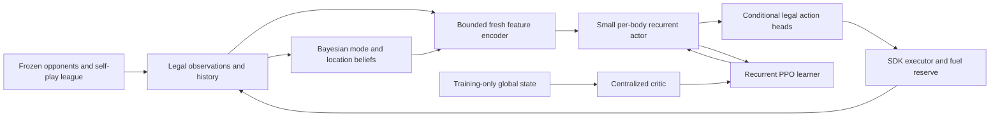

# Battlecode RL and Bayesian strategy design

Status: research/design, 4 November 2026. No live bot edits, new training, uploads or activations. Requested collaborator: R1shik123/Claude; response pending. Suggested choices below are hypotheses, not measured improvements.

## Decision

Build toward a compact, recurrent, parameter-shared actor trained with a centralized critic and a diverse self-play league. Feed the actor a small explicit belief state about hidden enemies and opponent behavior. Make the deployed execution semantics part of training from the start. Use CPG and v92 as frozen controls and teachers, never as evidence that the neural version is already stronger.

Use two separate tracks. A near-term residual policy can learn whether to retain or replace CPG's proposed target. The full-RL track eventually chooses draft, objectives, movement, combat, banking and purchases; remove teacher decisions incrementally. An actor choosing only target overrides is a hybrid, not full RL. Do not start another training process until the existing RL owner, checkpoint lineage and compute capacity are confirmed.

## Fresh repository evidence changes the starting point

Pinned CPG source: `cb8d0105e4047f75924556268f23053eb634699a`, flags CONTACT=3, PROGRESS=1, GOV=5. Agent2 now has two fast-forward commits after the previously reviewed 56b60b9: `94237a9cecee4e02cba629c174173d2658a5313c` and `0b0ae8e475c65c2901a0aad02842c58a0fee6c55`. Current published neural code is under `research/agent2-neural/code/`; its original local paths are not a portable checkout layout.

E124's published nnc4 result rows independently sum to 214/380 on 70 official maps against v92j3/j4/j5, 267/498 on 249 generated maps, and 61/100 on 50 unseen maps. Exploratory map-cluster percentile intervals from 10,000 resamples are respectively 50.5–62.2%, 49.4–58.0%, and 52–69%. These are win rates, not CPG-relative improvement intervals. Known-map opponent jitter is not unseen-map validation. Checkpoint selection saw multiple checkpoints on these suites; the intervals are not selection-adjusted promotion evidence. The checkpoint-4 versus checkpoint-0 paired gain on 280 common cells is +7.5 points, with a wide map-cluster interval of -1.43 to +16.79. No direct CPG-versus-nnc4 result is established.

Important findings to preserve:

- nnc4 is a v92 residual blend: v92 proposes a camp; the network overrides with a 2-logit margin. Banking remains v92. Its exact overrun rate is not established.
- Layout 4 has 556 inputs, versus layout 2's 500. Never drop its weights into the old CPG actor without an explicit layout adapter and golden tests. New global block is 22 wide and camp block 27 wide.
- E123 fixed coarse signed-log lookup interpolation. Old exported tables/headers need re-export; export precision and lookup parity both matter.
- The newly published `nn_export.py` still formats weights/tables with `:.7e` (eight significant digits), which does not guarantee float32 round trips. This is a source inspection finding, not a demonstrated gameplay regression. E0 must compare checkpoint values, the actual header and compiled results; the existing exact exporter from the CPG work is useful reference material, not a blind compatible replacement.
- More network width did not reliably improve results. At 20M fuel, delayed summaries materially hurt official-map results. Neither 20M wins nor offline imitation agreement is a deployment result.
- Approximately 94% of measured blend overrides retained the existing target when v92 wanted to switch. A cheap target-retention baseline is therefore a mandatory ablation, not a demonstrated replacement.
- The existing trainer records fresh camp features and stale summary features separately and recomputes the blend distribution. Keep that useful contract. Its debug-only sampling/logging does not incur release fuel costs; audit that exploration changes no policy computation, feature timing or scheduling.

Source: [Agent2 E120–E124](https://github.com/Infosuii/neural-networkk-battlecode/blob/0b0ae8e475c65c2901a0aad02842c58a0fee6c55/research/agent2-neural/docs/EXPERIMENTS.md). Companion `E124_AUDIT.json` contains the reproducible counts, input checksums and limitations.

## Research foundation and what transfers

| Primary paper | Relevant idea | Adaptation here / limitation |
|---|---|---|
| [Gym-μRTS, Huang et al.](https://arxiv.org/abs/2105.13807) | Full-game RTS with affordable simulation and structured actions | Closest engineering precedent; prioritize simulator throughput and action representation. Its single-map success is not a cross-map generalization guarantee. |
| [MAPPO, Yu et al.](https://arxiv.org/abs/2103.01955) | PPO is a strong cooperative multi-agent baseline | Treat our bodies as cooperating agents with shared reward and centralized training. Opponent nonstationarity still needs a league; the paper does not prove MAPPO best for Battlecode. |
| [OpenAI Five](https://arxiv.org/abs/1912.06680) | Long-horizon team competition and self-play | Borrow coordinated training and historical opponents, not its compute scale. No one-GPU timetable is inferred from it. |
| [AlphaStar, Vinyals et al.](https://doi.org/10.1038/s41586-019-1724-z) | League of adapting strategies and counter-strategies | Preserve historical competitors to limit forgetting and strategy cycles. Start with a small league rather than copying its infrastructure. |
| [Invalid Action Masking, Huang & Ontañón](https://arxiv.org/abs/2006.14171) | State-dependent legal action masking | Use the same masks in collection, loss calculation and WASM; do not hide strategic choices behind masks. |
| [Bayesian Policy Reuse, Rosman et al.](https://arxiv.org/abs/1505.00284) | Infer task identity from observed signals to select useful policies | Maintain posterior over opponent modes; begin with a belief-conditioned actor, not many expensive deployed networks. Opponents can be outside the assumed library. |
| [Policy Distillation, Rusu et al.](https://arxiv.org/abs/1511.06295) | Transfer policy behavior into a cheaper model | Distill on student-visited states and evaluate complete games; agreement on common stay actions is insufficient. |

These papers support components. The particular architecture, budgets and experiment order below are our proposed engineering design.

## Execution and observation contract first

Pin SDK 4.0.0 and engine 2.0.0. The observed deployment contract is 10M first-draft fuel, 200k first-body fuel and 100k ordinary-turn fuel; unused fuel does not carry. Verify these against the pinned engine before a run. Draft VM globals are not champion memory; use the documented 1,024-byte draft buffer. Team shared memory is constrained; never assume a free shared tensor or common simultaneous snapshot across bodies.

The environment adapter must expose exactly the observation available to the acting body at its actual call boundary. Actor inputs may contain visible entities, permitted public status queries, local history and explicitly shared messages. Actor input must never contain future observations or privileged training state. Replayed entity handles map to stable identities only for matching; numerical IDs/map hashes must not become policy features.

Keep observation, feature age, legality, chosen action, actual SDK action outcome and fuel accounting separate. Missing, hidden, dead and unreachable are distinct. Clear absent rows. Do not infer death solely from an observation gap. Reset recurrent state on actual lifecycle events; preserve/reset shared beliefs according to documented ownership and respawn semantics.

Model the action API faithfully: if a turn allows several ordered SDK calls, represent an ordered, conditional action bundle with masks recomputed after each executed phase. Do not assume movement, cast, attack and bank can be freely combined or reordered. The initial adapter must derive phases from SDK/source traces. Death is not necessarily episode termination because bodies can respawn; engine termination and collector truncation have different bootstrap rules.

## Actor architecture



Input is symbolic rather than pixels. Reuse the validated entity schema and cheap geometry, with a new versioned ABI for belief/recurrent features. Start with bounded rows: self; up to five allies; eight visible/recent enemies; ten candidate camps plus a deterministic overflow candidate; four altars; compact globals; candidate legal moves; timestamps and belief confidence. Test candidate coverage and truncation bias on large maps before fixing these limits. All selection/order rules must be shared by Python and C++.

Each entity type uses a small shared encoder (initially width 8). Masked pooling supplies context. A narrow context layer (initial width 32) and optional 16-state recurrent cell produce a local latent state. Entity pointers score candidate camps, targets and legal destinations using the same latent state. Champion type and role are explicit inputs; weights are shared across bodies, with per-body recurrent state. Test a feed-forward history-feature control before paying for recurrence.

The first deployable actor is a target-retention/replacement scorer, followed by banking and combat heads. The final actor covers objective/target, primitive movement, target selection, ability choice/parameters, banking/recall and purchases. Draft uses a separately trained pick/value policy, conditioned on current picks, team size and legal candidates. Avoid a single giant categorical head over every joint action. Conditional heads must use the joint log probability of the actions actually sampled, excluding inactive heads.

Deterministic code remains for SDK calls, legal masks, bounded feature extraction, observation transport and arithmetic. Distance fields can be observation features; the actor must choose goals and steps in the full-RL version. Keeping CPG's farm/fight decisions as the executor means the system is still hybrid. A safe legal no-op fallback is always defined, but its frequency must be measured and included during training.

Aim initially for roughly 8–12k multiply-accumulates per fast decision; that is a sizing hypothesis, not a fuel estimate. Entity extraction and normalization may dominate. Benchmark feature cost + inference + executor tail in release WASM before choosing widths. Test fixed-point/int16 or int8 kernels only when supported by the actual compiler/engine; unsupported SIMD and export tooling assumptions are not a plan.

## Bayesian inference: two small, explicit models

### Opponent behavior posterior

Use 4–6 empirically fitted latent behavior modes plus an unknown/broad component: for example farming, contesting, hunting/interception and banking/retreat. These names are hypotheses; validate whether modes predict held-out behavior rather than hand-labeling opponents by account. Learn event likelihoods from training opponents only, conditional on relevant observable context and our own actions. Marginalize unobserved choices instead of treating them as known.

For a new evidence event e at context x, use prediction b_minus = T^T b and update b(k) proportional to P(e | k,x) * b_minus(k). T allows the opponent to switch modes; fit/sweep its persistence on development data. Use log probabilities or bounded normalized fixed-point arithmetic. Include likelihood floors, an unknown mode and a prior mixture to avoid permanent certainty. Multiple consecutive sightings from the same uninterrupted move are correlated: do not apply them as independent evidence every turn.

Useful events include a genuinely observed target-direction change, contest entry, retreat at low health, or a publicly observable deposit. A deposit or action not legally observable cannot be used online. Draft alone is weak evidence: Agent2 reported opponent identification of only 46% in its earlier study. Initial draft priors should be broad.

Feed posterior probabilities, entropy and evidence age to the actor. In a hybrid experiment, use the posterior to adjust expected risk/value of candidate objectives, with bounded influence. Policy-library selection is a later alternative; evaluate the expected return under the whole posterior rather than always committing to its largest component.

### Hidden-enemy location belief

Maintain sparse probabilities over plausible nearby regions or camp/altar nodes, plus outside/unknown mass. Propagate through legal reachability given elapsed time and any permitted public alive/respawn status. Correct with fresh sightings and visibility-tested absence. Absence is evidence only where the sensor model says the enemy would have been detectable; bush/stealth and partial visibility matter. Expire stale information gradually. Do not claim an independent exact joint posterior over all enemies; a factored approximation misses coordinated attacks.

This belief yields expected enemy arrival time, probability of contest during a trip, and exposure while carrying gems. For example, banking can compare expected deposited value after survival with another trip's expected value. Those probabilities need calibration against held-out traces before affecting actions. Do not add MCMC, online network weight training or an unbounded particle filter to each turn.

Budget beliefs explicitly: one local update per new evidence event, bounded sparse state, and compact shared summaries with timestamp, writer and deduplication key. Local posterior state need not be shared in full. A precise bit allocation waits for the actual shared-memory ownership audit; claiming that it fits without that audit would be premature.

Measure Brier score/log loss, calibration by confidence bin, unknown-mode frequency, change-detection delay, memory and fuel. Better prediction alone is insufficient: require improved matched game outcomes at equal runtime. Ablate beliefs off, fixed prior, stale-history baseline, calibrated posterior, and randomized posterior of equal compute. This separates inference value from extra features or changed timing.

## Learning setup

Begin with recurrent PPO/MAPPO as a baseline: decentralized shared actor; a richer critic can see training-only global state plus agent identity/alive masks. Keep critic inputs out of exported weights/features. Recurrent collection stores initial hidden state, reset masks, sequence boundaries and burn-in. Recompute logits from the exact fresh/stale features, action masks and hidden state used during collection. A bad behavior log-probability match blocks training, rather than merely logging a warning.

Proposed pilot settings, to tune on development data: gamma .995 per engine round; GAE lambda .95–.98; PPO clip .1–.2; 2–4 update epochs; learning rate 1e-4 to 3e-4; entropy annealed from a small nonzero coefficient; gradient clipping. Store elapsed engine rounds between decisions and discount across actual duration. If rewards accumulate between decisions, discount that interval consistently. The existing trainer already handles variable decision gaps in part; audit final terminal discounting and respawn continuity before reuse.

Primary objective is team win/draw/loss. Add modest deposited-gem advantage and potential-based shaping for learning, with explicit terminal-potential handling. Do not use arbitrary kill/hoarding/survival rewards as the permanent objective: they can reward avoiding a winning bank. Evaluate with terminal outcomes regardless of training reward. Fade teacher KL and auxiliary shaping, and verify the final policy still improves. CPG imitation is a warm start; learned control must demonstrate departures that improve outcomes.

Start opponents with frozen CPG, v92, distinct historical scripted styles and self-play snapshots. A candidate initial mixture is 40% recent self-play, 30% historical self-play, 20% scripts, 10% targeted exploiters; these are sweepable proposals. Add exploiters only when there is an actual population weakness. Freeze opponent policy for each episode, version every update and bound actor policy lag. No league training is currently launched.

Map splits are by map lineage/family and seed, not replay row. Freeze train/development/final suites before collecting labels. Stratify geometry, sizes, resource layout, team sizes, champion types and sides. Mirroring is allowed only when game semantics and champion/action transformations are valid. No map fingerprints or opponent account IDs enter the actor.

Train and collect with the same visibility, cadence, feature ages and fallbacks as deployment. Prefer training the small deployable actor directly. If a larger teacher helps, distill on student-visited states and fine-tune the student with RL. A privileged critic is allowed; a privileged policy teacher cannot silently introduce information unavailable to the student. Compare without explicit beliefs too, because recurrence may already encode sufficient uncertainty.

## Runtime and compute structure

CPU workers run official-engine local games; a single learner batches updates on the available GPU. First measure end-to-end games/second, useful actor decisions/second, GPU utilization, CPU/RAM pressure and update time. Agent2 reports RTX5060 training and the earlier builder used RTX5070Ti; neither is confirmed free now. Size workers from measured resource use, not a presumed high-end cluster. A fast surrogate environment is optional only after trajectory/action/reward conformance to the official engine; final selection always uses release WASM and official fuel.

Release targets: leave a measured executor reserve; never add hypothetical neural fuel back to an actual admission budget. Start with a proposed <=20–25k incremental fast-path budget and reduce it if baseline tails demand more. A percentile is not a hard bound; enforce bounded work, feature caps and conservative admission, and test adversarial large-map/contact/first-turn cases. Static map summaries can be cached; dynamic self/enemy/current-target features need fresh timestamps. If staging is retained, its mixed-age observation is part of the trained state.

Weights are embedded read-only; model ABI records feature layout, normalization, action schema, masks, quantization, lifecycle/reset rules and hashes. Export needs float32 round-trip precision or exact hex literals. Tests compare Python, host C++ and release WASM on ordinary, absent-entity and extreme observations; record both logits and action agreement, especially near ties. Quantization requires in-game retesting, not just numerical error checks.

Suggested new module layout (not created as a bot yet):

```
research/jd-rl-belief-1104/        design, source audit, immutable experiment registry
tools/jd_rl_belief_1104/env/      official-engine adapter, observation/action schemas
tools/jd_rl_belief_1104/belief/   fitted opponent modes, sparse filter, calibration
tools/jd_rl_belief_1104/train/    actor/critic, recurrent PPO, collector, league
tools/jd_rl_belief_1104/export/   manifest, numerical goldens, release fuel bench
bots/jd-rl-belief-<run>/src/      independently owned candidate when assigned
```

## Experiment order and decisions

1. **E0 reproducibility and timing.** Pin nnc4 builder flags/checkpoint/exporter; recreate the CPG and neural controls on an authorized compute host. Compare release/source hashes, primitive actions, masks, feature phase, and actual release fuel. Audit debug-only sampling/logging and the known late-score gap. Exit: equivalent deterministic trace before exploration, or a documented discrepancy that is fixed first.
2. **E1 cheap explanation control.** Compare frozen CPG, v92, nnc4 residual, and an explicitly specified target-retention rule. Same maps, sides, opponents, seeds and official fuel. Run fresh frozen opponent families and never-used map lineages, including CPG-versus-nnc4 direct cells. Keep the rule hypothesis separate from Agent2's own in-progress test. Exit: does the learned policy add value beyond retention and scheduling?
3. **E2 Bayesian feature feasibility.** Fit context-conditioned opponent likelihoods and sparse location transitions offline; measure held-out calibration. A bounded reference implementation gets numerical/event-dedup tests, then release WASM fuel tests on its own branch. Beliefs remain observational until memory and calibration gates pass.
4. **E3 controlled hybrid ablation.** Train the same small residual actor with beliefs off/on, plus equal-cost randomized-belief and fixed-prior controls. At least three learner seeds; developmental equal-compute budgets. Exit: reproducible action-value gain beyond added compute/features, no new fuel failure mode. If no gain, retain recurrence/history alone.
5. **E4 learned macro.** Replace target/bank decisions while retaining fixed movement/combat temporarily. This is still hybrid. Validate winner-oriented reward and opponent/map transfer; check action truncation coverage.
6. **E5 full learned control.** Add movement, combat, abilities, purchases and draft in separate gated experiments; then train jointly. Run the same legal executor with no CPG strategic fallback in a controlled evaluation arm. Report residual reliance instead of calling a mostly heuristic system full RL.
7. **E6 frozen confirmation.** Predeclare candidate, maps, opponent hashes, metrics and failure limits; run once after selection on untouched suites. Report paired game-outcome differences and map/family-cluster uncertainty, seed variability, per-opponent/category regression, missing cells, cap/fault rate, cost and fallback share. Do not repeatedly select on this suite. Platform qualification is a separate explicitly authorized action.

Promotion needs stronger evidence than the existing published win rates: direct matched comparisons against CPG/v92 and diverse opponents, a positive predeclared improvement bound on frozen local suites, and acceptable tail runtime. Exact sample sizes should follow a development pilot's map-cluster variance and desired minimum gain, not an arbitrary number of correlated games. No promise of a training duration or final strength is justified yet.

## Collaboration and immediate handoff

JOHNDOE owns this design and offline result audit on `johndoe/rl-belief-design-1104`. R1shik123 was asked in issue5 #21/#22 for a new READY session, capacity/access and critique of execution equivalence and cheap belief features. Their previous session explicitly stopped; a GitHub comment does not restart it. No response or compute is assumed. Agent2's newer research is source material, not authorization to take over its training. Any implementation/heavy-run owner needs a distinct branch/run namespace and current assignment ACK. The old monitoring automations remain deleted.

First handoff to a verified compute owner is E0, not a long blind training run. If R1shik123 cannot respond, the concrete remaining dependency is collaborator/compute availability; the research document and audit can still be reviewed independently. CPG delivery and live v80 are unchanged.
