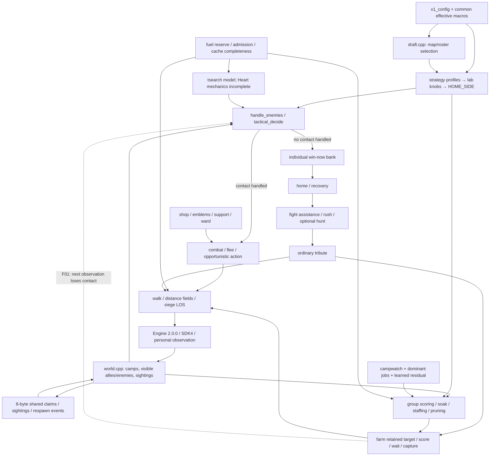

# x1: deep replay and code dependency audit

**Analysis-only report · 2 November 2026 · frozen match cutoff: 1 November 2026,23:10:04.114 UTC**

## Executive diagnosis

The strongest evidence points to a policy handoff problem, uneven resource throughput, and poor conversion of some competitive farming positions into banked score. The source also contains verified combat-model and camp-model errors. A successful build alone would not expose those errors.

1. **Retreat and farming contradict each other across contact boundaries.** In two fully reproduced losses, the bot retreats and then resumes the same camp approach. In cuts this tracks enemies disappearing from personal vision; in galaxy enemies remain visible but contact policy falls through to farming. Repeated approach/flee precedes a death. The source chain and private target/mode trace agree. In cuts, the exposed Cassi also kills a distant, healthy linked Issac carrying 73 gems. In galaxy, Marcella loses 42 gems after repeated approach/flee alternation. This is a confirmed execution conflict; the number of victories it cost is unproven.
2. **The loss cohort usually loses the collection race, even when survival is comparatively good.** Nine of 11 source-verified losses end behind in collection. Dunes has a 177-gem adverse collection swing in 40 rounds while x1 waits/stages across several targets. Pilgrimage finishes with 359 collected against 1016. These are measured deployment/throughput failures; the precise scoring term responsible is not established in every game.
3. **Some games are lost after adequate collection.** Cuts collects 1106 against 1102 but banks 859 against 1083, loses 77 gems and finishes carrying 170. Galaxy collects 1133 against 1011 but loses 152 and finishes 30 unbanked. The individual winning-bag check does not sum the team's actual carried bags. This diagnoses failed conversion, without assuming every bag could safely have been banked in time.
4. **The active combat forecast uses incomplete champion mechanics.** The unchanged-model diagnostic produces zero Heart of Ruin dash landing damage/stun where the rules specify 150 damage and one stun tick, and 30 basic damage instead of 37.5 at half health. The relevant bits are off in the effective configuration. The fight/run forecast is active despite the separate full action-search switch being off. Its existence as a bug is established; a decisive wrong replay verdict has not been isolated.
5. **Several technical contracts are false or incomplete.** The camp danger model ignores members after 12 although a published group contains 48 wolves. Candidate pruning precedes later positive bonuses, so the preliminary score is not a general upper bound. Fast siege can accept incomplete cached geometry under low fuel. These are verified source inconsistencies with differing, explicitly limited evidence of competitive impact.

**No fixes or implementation recommendations are included**, following your later instruction. Production code was preserved. No bot was uploaded, activated or deployed by this audit.

## What was actually analysed

The audit processes **35 complete games, 16 losses and 19 wins, 39,694 played rounds plus 35 opening states**. No selected round was sampled away. Selection retains complete five-game sets, including wins, instead of choosing only unfavourable moments. The available opponent ranks are snapshot ranks, not claims that these opponents were the current top 10.

| Opponent | Rank snapshot | Games | Wins | Losses | Exact attached-source games |
| --- | --- | --- | --- | --- | --- |
| an iq too high | 66 | 5 | 3 | 2 | 5 |
| SilverSamurai | 49 | 5 | 0 | 5 | 5 |
| 0xDEADBEEF | 47 | 5 | 2 | 3 | 5 |
| Shawarma 🐫 | 60 | 5 | 4 | 1 | 5 |
| The Party of Heroes | 48 | 5 | 2 | 3 | 0 |
| EggsAfter11AM | 59 | 5 | 4 | 1 | 0 |
| dromedaries | 58 | 5 | 4 | 1 | 0 |

The **primary source-attributed cohort is 20 games:11 losses and 9 wins**. An official release build of the attached x1 source, facing an opponent that repeats the accepted recorded actions, reproduces each of those 20 native replay files **byte for byte**, with zero opponent input rejections. This validates the source's entire observable action trajectory on these games, not just the final score.

The other 15 games remain **context only**. All were fully reconstructed, including the newly played EggsAfter11AM and dromedaries sets, but the attached source does not reproduce them. The API match listing does not identify their submission hashes. Their different behaviour could reflect another source/build/runtime; the cause was not established. They are not used to assign private decisions or fuel behaviour to current x1. [COHORTS.csv](COHORTS.csv) and [source-fidelity.json](source-fidelity.json) retain the first divergence for each mismatch.

No selected QS2isLaw replay was available in the retrieved relevant listing; no claim about a QS2isLaw-specific defect is made. Eight primary losses are against SilverSamurai/0xDEADBEEF; three are against the other source-verified opponents. The minimum ten-loss target is met overall, not as ten proven losses to top 10 opponents.

## Source, rules and build identity

The user archive is `C:/Users/omdha/Downloads/x1.zip`, SHA 256 **6ea200693b29ad7c615d138de058825467cdf7a39672f667f11ec94278a9955a**. At the submission snapshot, active x1 was platform version 73, submission `17fb5d32-849d-426c-ad91-40f6d5e18529`, filename x1.zip, 288180 bytes. Archive filename/size match that record; the server did not expose a cryptographic source hash. The 20 exact reproductions provide behavioural corroboration. Platform version numbers must not be confused with the repository's unrelated historical `bots/v73` folder.

All 34 extracted source files match the archive exactly: [SOURCE_PRESERVATION.json](SOURCE_PRESERVATION.json). The official release build uses CLI 4.0.0, Clang 22/WASI SDK 33, C++20 and engine 2.0.0. Its injected WASM SHA 256 is **1746f2bb7fa341530f41bd8c8c4896b35172783f35eacee8e4a4b6ac0ceea183**. All local include dependencies resolve; compilation and 20 full runs found no missing import, link dependency, bot fault or crash in the primary cohort. This is positive evidence against a basic build/dependency failure, not proof that the algorithms are correct.

The v86h submission record exists (platform 74; `e3afb26c-5aa8-4e15-84e3-c00567aaeee1`; v86h_engine4.zip), but its source/archive was not supplied or found. The plan's57.9% over 480 games, 60.4% league result and 8–7 ladder record remain historical claims, not reproduced benchmark results.

The pinned native engine was used to reconstruct the replays; [engine-facts.json](engine-facts.json) verifies capture 5, camp sleep 2, respawn 60, recall 5, tribute multiplier 0.1/minimum 1/range 1, winning threshold 1000, maximum 2000 rounds, 8 shared bytes and 1024 draft bytes. At the round limit, banked gems are followed by lifetime gold, then kills, then Team B. This matters: the 03homonoliths comparison win ends 0:0 banked at round 2000; it is not a 1000-gem victory.

Rules and source agree that personal vision is not shared team vision. Kills transfer carried gems; camps destroy carried gems. Banking channels consume time; a bag in hand is not yet score. Melee may move and attack, whereas ordinary ranged movement and attacks share an allowance. One successful ability cast is shared across both slots. Camps do not chase. These mechanics constrain the interpretation of deaths, delays and apparent inactivity. Rules references: `game rules/GameRules.md:27,100,116,207,338,354,362,380–398,803–813` in the workspace.

## Full-round evidence and validation

Each match has a complete [decoded](EVIDENCE.md) CSV and JSONL, keyed by its full match UUID. JSONL contains completed-round/terminal-partial states, unit positions/alive/HP, banked and carried gems, gold, items, cooldowns, charges, channels, respawn timers, camps/groups, accepted physical actions from both teams, native events, per-actor available observations and resource deltas. It includes the opening round 0. The CSV provides a smaller per-round ledger and arithmetic strategic consequence.

Private roles and targets are **null where the replay does not reveal them**. They are not reverse-invented from movement. [PRIVATE_STATE_TRACES.jsonl](EVIDENCE.md) adds 494 private records from three faithful source traces. These are post-turn records; cached self fields after an early dead return do not establish that a unit is alive. Native state is authoritative. Per-turn available views and omniscient completed-round states are intentionally distinguished.

Validation comprises:

- **1,123,632** checks against independent native unit resource timelines and **79,458** team conservation checks; all passed.
- **920,039 accepted inputs** independently reapplied through the official engine; **39,729 round states** matched and all 35 replay serializations were byte identical.
- Native terminal scores match the derived ledgers in all 35 games. Continuous round numbering is checked. Each replay has its own hash and validation receipt.
- Action 23 is **movement blocked**, not a dash. Action 22 is teleport completion; action 26 is turn rollover and does not itself prove fuel exhaustion. Exhaustion counts come from native events.

[TIMELINES.md](TIMELINES.md) gives readable event windows for all 35 games. [CONTACT_WINDOWS.csv](CONTACT_WINDOWS.csv) records the exact available enemy distances for the two retreat cases. [LOSS_CASES.md](LOSS_CASES.md) gives a diagnosis and attribution status for all 16 losses. [FAILURE_MAP.csv](FAILURE_MAP.csv) connects each loss to evidence and identifies source branches that remain unresolved. These highlights supplement every-round records; they do not replace them.

## Loss accounting: collection, preservation and conversion

For each team, **banked = collected − lost carried gems − currently carried**. Collection includes resources obtained during the game, including transferred bags as represented in the native ledger. The components below therefore describe accounting, not independent causal interventions.

Across the 11 primary losses, the average terminal bank margin is **-448.9 gems**:

| Component, own minus opponent convention | Total over 11 losses | Mean per loss | Share of net bank deficit |
| --- | --- | --- | --- |
| Collection difference | -3368 | -306.2 | 68.2% |
| Preservation: enemy losses minus own losses | -1110 | -100.9 | 22.5% |
| Terminal conversion: enemy carry minus own carry | -460 | -41.8 | 9.3% |

The 68.2% collection share is a decomposition of this selected cohort's net deficit. It is not evidence that a collection intervention would recover 68.2% of losses. The cohort is deliberately diagnostic and is not an unbiased estimate of x1's ladder win rate. No finishing-time projection is reported where intermittent camp rewards, combat transfers and the terminal stopping rule make a simple linear estimate misleading.

| Opponent / map | Terminal R | Bank own:enemy | Collected | Lost bags | Still carried |
| --- | --- | --- | --- | --- | --- |
| an iq too high / 00elkring | 878 | 814:1019 | 883:1131 | 0:67 | 69:45 |
| an iq too high / 00rushbait_v2 | 1061 | 620:1005 | 797:1079 | 20:15 | 157:59 |
| SilverSamurai / 03showdown | 1042 | 372:1085 | 903:1351 | 531:266 | 0:0 |
| SilverSamurai / 02cuts | 995 | 859:1083 | 1106:1102 | 77:19 | 170:0 |
| SilverSamurai / 00galaxy | 1589 | 951:1011 | 1133:1011 | 152:0 | 30:0 |
| SilverSamurai / adgato_gemcombat3 | 837 | 742:1085 | 1078:1085 | 308:0 | 28:0 |
| SilverSamurai / adgato_gemcombat1 | 1318 | 735:1022 | 903:1095 | 126:63 | 42:10 |
| 0xDEADBEEF / 00dunes | 824 | 633:1060 | 655:1205 | 18:145 | 4:0 |
| 0xDEADBEEF / 03membrane | 555 | 315:1020 | 465:1024 | 60:0 | 90:4 |
| 0xDEADBEEF / 00pilgrimage | 1374 | 309:1000 | 359:1016 | 34:0 | 16:16 |
| Shawarma 🐫 / 03fan | 1153 | 120:1018 | 551:1102 | 415:56 | 16:28 |

## Case 1: cuts — retreat returns to the same danger, linked bag dies remotely

Match `29ce3d7a-2c6d-4e29-acc7-a63ab0c3b294`, SilverSamurai. Native replay and the tail-instrumented source both remain byte identical over the complete 995-round game.

The Cassi trace retains target G22. At R852 she flees to(37,32), HP 380, with three visible enemies. R853 switches to `wait-respawn` at(36,31), zero visible enemies. R854 flees to(37,32), one visible enemy. R855 returns to `wait-respawn` at(36,31), zero visible enemies. The same alternation continues through R861. This is direct private-mode evidence, not merely an ABAB position detector.

At **R862 Cassi dies**, and her linked Issac dies at(46,44), losing **73 gems**. Issac had 1687.4 HP at the previous completed round and no enemy within five tiles there. Cassi's own bag was zero. The risk is joint exposure of a linked pair; classifying Issac as an isolated physical death misses why it occurred. The prior-round proximity statistic is not an exact turn-time visibility measurement.

Execution chain:

1. [world.cpp:565](SOURCE_REFERENCES.md#worldcpp-l565) clears/rebuilds the current visible-enemy list. Recent sightings are retained separately.
2. [bot.cpp:3169](SOURCE_REFERENCES.md#botcpp-l3169) returns false from `handle_enemies` when that visible list is empty. [bot.cpp:4033](SOURCE_REFERENCES.md#botcpp-l4033) records `last_flee_round` during danger, but [bot.cpp:4408](SOURCE_REFERENCES.md#botcpp-l4408) applies that cooldown to hunting, not the normal farm path.
3. [bot.cpp:7334](SOURCE_REFERENCES.md#botcpp-l7334) lets handled combat own the turn. With no handled contact, the chain can reach `farm` at [bot.cpp:7354](SOURCE_REFERENCES.md#botcpp-l7354).
4. `farm`, [bot.cpp:6191](SOURCE_REFERENCES.md#botcpp-l6191), keeps the selected group; its respawn wait branch builds a nearby goal and calls `walk_toward` at [bot.cpp:6526](SOURCE_REFERENCES.md#botcpp-l6526). Target G22 survives the retreat.
5. `walk_toward`, [bot.cpp:1042](SOURCE_REFERENCES.md#botcpp-l1042), executes that farming movement. The general farm threat options are off; A2_TEAM2 enables joining, not its hold bit. Some banking/escape paths still use threat memory, so it would be wrong to say x1 has no threat-aware routing anywhere.

**Established:** an information-dependent priority handoff causes repeated opposing actions and renewed exposure. **Not established:** that a particular alternative wins this game, or that campwatch specifically selected G22. The trace does not expose every candidate score.

The endgame is a second issue: at R995 x1 has 859 banked and 170 carried against 1083 banked. Cassi collects 88 at R977; the final carried bags are distributed 70/88/8/4, so no single bag covers the 141 still needed. `win_now`, [bot.h:427](SOURCE_REFERENCES.md#both-l427), tests the current unit's bag plus global score. The terminal sum 1029 does not prove a feasible safe collective banking schedule before the opponent's finish.

## Case 2: galaxy — a carrier repeatedly approaches and flees

Match `b4eb7654-6070-4dba-b131-39a346f56d6a`, SilverSamurai; faithful private trace R330–378, with 49 records and an identical full replay.

Marcella approaches G6 at(69,30) on R355 carrying 42 gems, flees to(70,31) on R356, approaches again R357, flees R358, approaches R359 and flees R360. After an ambush/cast and further approaches, HP falls to 1010 at R365,870 at R366 and 800 at R367. `headingHome` is set by R370, but **she dies R376 and loses 42**. The farm/retreat handoff is established, but this is not the cuts visibility-empty mechanism: Marcella still sees three enemies on R355–360. The nearest visible distances at turn start are 6,3,5,3,5,2. At R355 the melee target-selection cutoff is range+4=5; other non-engagement returns are at bot.cpp:4163/4168. The exact internal winning/danger predicate at each reversal was not logged. Subsequent movement can involve recovery or retreat, so the report does not label every later turn as the same farm branch.

Final bank **951:1011** hides a collection lead **1133:1011**. Own lost bags total 152; enemy loss 0; own carry 30. That makes conversion/preservation a decisive observed weakness in the score identity. A42-gem transfer changes relative held resources by 84 at transfer time, but this is not a certified 84-point terminal improvement under another policy.

## Case 3: dunes — collection stalls while the enemy finishes valuable groups

Match `f0116be3-baf3-43d7-b8e9-3c6dba8259d1`, 0xDEADBEEF; five own actors faithfully traced R400–475,380 records, identical full replay.

R100 is **61:61 collected**, earned gold 136:130. The first own death is R111; this game does not support a universal opening deficit narrative. The important midgame interval is **R431–471: own collection 0, enemy 177**. Enemy Vesper collects 50 from G3 at R436 and 21 from G1 at R445; enemy Marcella clears G0 at R467 and collects 106 at R471.

At R450, x1's targets/modes include Vendetta waiting for G4, Marcella staging for G0, Willow staging for G4, Heart approaching G1 and Varg staging for G0. Similar waiting/staging persists near R470. The opponent converts actual clears into rewards during this window; x1 does not. `champions_needed`, `score_groups`, and `fight_camps` jointly determine staffing, target value and whether to stage. Private targets are established, but a complete causal decomposition among those calculations is not.

The game ends 633:1060 banked, 655:1205 collected, 18:145 lost bags. **x1 preserved bags better and still lost by 427.** This is why a diagnosis focused only on feeding or isolation would be incomplete. Base map rewards and current native payouts differ through champion/item effects; the native event totals are used for the swing.

## Code architecture and effective dependencies

The source inventory covers 34 source files, 52 local/include edges, 198 extracted function/declaration entries and 617 conditional feature/threshold identifiers. These counts are inventories, not a claim that 617 independent features were experimentally evaluated. The repository catalogue contains 9631 tracked paths; the relevant rules, build machinery, prior reports, replay decoders, puppet reconstruction and source families were inspected. Historical repository results were used as context and tooling, not substituted for current replay proof.

The include graph is in [INCLUDE_DEPENDENCIES.csv](EVIDENCE.md); file hashes, function locations and effective macro values are in [source-inventory.json](EVIDENCE.md), [FEATURES.csv](FEATURES.csv) and [effective-macros.txt](EVIDENCE.md).

The main priority chain is `profile/knobs → self/channel guards → world/communications → shop/support/ward → contact combat → individual winning-bag tribute → home/recovery → fight assistance → rush/fog/hunt when enabled → ordinary tribute → farm → opportunistic actions/tail`. See [bot.cpp:6653](SOURCE_REFERENCES.md#botcpp-l6653), [bot.cpp:6879](SOURCE_REFERENCES.md#botcpp-l6879), [bot.cpp:7289](SOURCE_REFERENCES.md#botcpp-l7289), [bot.cpp:7314](SOURCE_REFERENCES.md#botcpp-l7314) and [bot.cpp:7334](SOURCE_REFERENCES.md#botcpp-l7334). A branch that returns true claims the turn; later high-level policies do not get a vote. This explains where strategic preferences can be superseded without any missing include or crash.

Effective configuration details that materially change interpretation:

| System | Audited effective configuration / implication |
| --- | --- |
| Plan additions | X1_FAST_SIEGE1 and A2_CAMPWATCH1; early x1_config overrides later guarded defaults. |
| Combat forecast versus action search | APEX_TS_DECIDE1; A2_SNAP4; A2_TD_AUTH1. APEX_TSEARCH0 disables the separate action search, not the fight/run forecast. |
| Champion model | A2_KITFIX25 (bits 1,8,16), A2_DASHX0, TS_DASHX0. Missing-health bit 4 and dash extension bit 2 are off. |
| Coordination | A2_TEAM2 enables join-fight; hold bit 1 is off. Full role/squad/central economy director switches are off. |
| Threat and memory | A2_THREAT0, A2_DANGERMAP0, APEX_THREAT_PATH0; current enemies and remembered sightings have different consumers. Banking still builds a threat route for bags>=15. |
| Banking | A2_RACE0 disables projected finish-time posture. Winning-bag and ordinary banking remain active. A2_HIDEREC0; channel guard is active. |
| Profiles | APEX_BRAIN1; profile writes are followed by lab knob transformations and HOME_SIDE (HOME_TERR0.3/HOME_AGGR0.8). Effective values are products of those layers. |
| Hunting | APEX_HUNT1 is not sufficient: effective class profiles have hunt off, and lab knob 15 does not cross its enable threshold. Assistance/other tactical actions remain possible. |
| Lab/learning | A2_LAB1 forces learner::on; NOVA_LEARNER0 does not remove all gathering work. Zero default runtime learner weights are distinct from the nonzero 321-parameter ngp score residual. |
| Deterministic budget | Reserve 35000; scoring admission 16 candidates; tactical budget 70000; unit cost 2200; field work 2. Fuel-sensitive admissions can change choices before exhaustion. |
| Camp value | Campwatch 1.6 with lead 12/memory 150; dominant group share 0.6, fromR 60, multiplier 6; target stickiness 1.523. These modify a scorer that has already pruned candidates. |
| Disabled families | V58_DIRECTOR0, V58_SURVIVE0, ROLE_SQUAD0, APEX_FIGHT_SIM0 and full action search 0 are not explanations for a branch executing in this build. |

### Source coverage by responsibility

| Files | Responsibility / audit result |
| --- | --- |
| main.cpp, draft.cpp, draft.h, draft_net.h | Dispatch, draft/map tables and learned draft values. Actual draft/action sequence validated in 20 full reproductions; no isolated draft-strength experiment. |
| common.h, x1_config.h, strategy.h, lab.h | Compile-time defaults/overrides, mutable profile parameters and host-lab controls. Effective preprocessing used rather than comments. |
| bot.cpp, bot.h | Primary decision order, movement, gear, camp valuation/staffing, fighting, recovery and tribute. Confirmed F01 chain; B02–B04 source contracts. |
| world.cpp, world.h, a 2map.h | Personal visible state, remembered sightings, camps/events/fields and map features. Correct visible-state clearing participates in F01; event-date ambiguity H01. |
| tsearch.cpp, tsearch.h, fight.cpp, fight.h | Fight/run forecast, combat model and tactical helpers. Heart mechanics bug B01; separate disabled search distinguished. |
| tactics.cpp, pressure.cpp, deny.cpp | Contact/capture/denial and local tactics. Earlier contact returns can supersede general combat; no independent lost victory assigned. |
| economy.cpp | Central economy director body exists, but V58_DIRECTOR0 means it is not the active allocator. |
| neural_policy.cpp, neural_policy.h, neural_weights.h, learner.h | Learned residual and learner/lab dependencies. Nonzero residual weights versus default-zero runtime learner separated; no training-quality claim. |
| act_model.h, assess_model.h, move_model.h, tile_model.h, local_model.h, ml_plan.h | Model headers/optional learned mechanisms inventoried with their effective gates; no blanket claim that every embedded model is active. |
| episode.cpp, ep_model.h, runtime_budget.h | Episode and budget helpers. Budget safety/admission distinct from native exhaustion. |

## Bug and logic-error register

The ordering below reflects diagnostic importance and evidential strength, not a proposed implementation plan. “Verified” describes the named defect or observation; it does not silently mean a win-rate benefit has been measured.

| ID | Classification | Finding | Outcome evidence |
| --- | --- | --- | --- |
| F01 | confirmed policy conflict; outcome causality incomplete | Retreat hands control back to the retained farm target as current contact conditions change; cuts loses vision, while galaxy crosses engagement conditions with enemies still visible. | high for execution conflict and loss events; no measured win-rate effect |
| F02 | confirmed strategic outcome; exact allocation cause partly unresolved | Camp deployment and conversion fall behind on several maps even when bag preservation is good. | high for throughput deficit; medium/low for which scoring component caused it |
| F03 | confirmed outcome; banking policy weakness hypothesis | Competitive collection does not reliably become banked score before the opponent finishes. | high for accounting; incomplete for feasibility of banking every bag safely |
| B01 | verified combat-model mechanics bug | Active tactical forecast omits Heart of Ruin dash landing damage/stun and missing-health damage amplification. | high for mechanics mismatch; competitive impact unmeasured |
| B02 | verified model truncation on a published map | group_soak ignores dangerous camps after the first 12 in a group. | high for truncation; actual exposure and match impact unresolved |
| B03 | verified scoring-bound inconsistency; replay incidence unresolved | Early candidate pruning does not bound the score after later positive multipliers. | high for invalid general upper-bound claim; occurrence/effect not demonstrated |
| B04 | verified conditional semantic mismatch | Fast siege accepts a partial line-of-sight union under low fuel, despite a same-tiles claim. | high for branch semantics; match impact unknown |
| H01 | shared-state representation risk | A stale modulo 256 respawn event can be interpreted as a future event after its 64-round reconstruction window. | high for representational ambiguity; low for actual replay incidence |
| H02 | shared-state coordination hypothesis | A remembered group claim need not mean the claimant is still travelling to or working that group. | medium for stale-intent possibility; low for a specific lost allocation |
| C01 | configuration/dependency hazard; no failed build observed | Effective features differ from nearby default comments and some nominal off switches do not disable all dependent work. | high for configuration facts; no standalone losing-decision attribution |

### B01: incomplete Heart mechanics in an active forecast

[tsearch.cpp:55](SOURCE_REFERENCES.md#tsearchcpp-l55) sets the dash stun flag only if TS_DASHX is enabled. [tsearch.cpp:84](SOURCE_REFERENCES.md#tsearchcpp-l84) sets U_RUIN only with A2_KITFIX bit 4. [tsearch.h:228](SOURCE_REFERENCES.md#tsearchh-l228) gates missing-health damage and [tsearch.h:301](SOURCE_REFERENCES.md#tsearchh-l301) gates dash landing effects. The effective values turn both off. [bot.cpp:3678](SOURCE_REFERENCES.md#botcpp-l3678) still calls `tactical_decide`, which can override the fight/run assessment. The model diagnostic invokes these unchanged model primitives in a synthetic two-unit state; [model-audit.json](model-audit.json) includes output and hashes. Actual engine ability metadata independently confirms dash range 2, radius 1, modifier 1.5 and stunDuration 1. The fixture establishes an internal mechanics error, not the actual forecast verdict at cuts/galaxy or a whole-match improvement.

### B02: twelve-member camp danger truncation

[bot.cpp:4741](SOURCE_REFERENCES.md#botcpp-l4741) allocates 12 entries; [bot.cpp:4746](SOURCE_REFERENCES.md#botcpp-l4746) skips all further dangerous members. Published 02the-pack G0 has 48 wolves. This is a model coverage error on a real supported map, not an out-of-bounds write. `champions_needed` consumes the soak coefficient at [bot.cpp:4761](SOURCE_REFERENCES.md#botcpp-l4761). Within the model's identical-monster sequential assumptions, the coefficient grows as n(n+1)/2:78 for 12 versus 1176 for 48. Actual incoming damage depends on geometry/engagement and is not certified to be 15.1 times larger. No selected pack match establishes a resulting lost victory.

### B03: bonuses occur after a supposedly optimistic prune

[bot.cpp:5647](SOURCE_REFERENCES.md#botcpp-l5647) forms `best_case` from raw gems/gold, middle multiplier, stickiness and travel/wait/capture terms, then drops candidates below `prune_bound`. Campwatch at [bot.cpp:5734](SOURCE_REFERENCES.md#botcpp-l5734) and dominant-group 6x at [bot.cpp:5760](SOURCE_REFERENCES.md#botcpp-l5760) are later positive multipliers. An algebraic example including stickiness is raw value 100, optimistic cost 10 and stickiness 1.523: the bound is 15.23. With a neutral remaining cost and campwatch 1.6, the score is 16, exceeding a possible incumbent 15.5 despite being pruned. This disproves the general upper-bound interpretation; it is an abstract witness, not a reconstructed reachable game state. It does not prove that a particular discarded current-game candidate would win the final selection; full costs and later terms also matter. No claimed A/B interaction size is inferred from this code alone.

### B04: fast siege cache accepts a partial result

[bot.cpp:4850](SOURCE_REFERENCES.md#botcpp-l4850) describes caching as yielding the same goal tiles. Cache construction skips unready camps below 30000 fuel and marks the result incomplete. [bot.cpp:4898](SOURCE_REFERENCES.md#botcpp-l4898) nevertheless uses `complete || true`, so any nonempty partial union replaces the ring. Stable walls/camps make a completed cache reasonable; the contract failure is the incomplete case. Current-loss incidence is unmeasured. This is not presented as a proved cause of dunes or the named opponents' wins.

### H01/H02: compact shared state can outlive its meaning

The eight-byte protocol multiplexes claims and sightings/respawn events. At [bot.cpp:680](SOURCE_REFERENCES.md#botcpp-l680) a modulo 256 ready date is reconstructed relative to `round−64`, without a publication round. An old ready 100 decodes as 100 at R164 and 356 at R165 if that tagged message survives. [world.cpp:459](SOURCE_REFERENCES.md#worldcpp-l459) protects personally visible groups, but can set an unseen group to a future respawn state. This is a representational ambiguity, not a measured occurrence. The replay does not record private shared-memory bytes.

Similarly, a target claim is not a complete declaration that the claimant is currently farming it. F01 proves target retention during flight; a specific resulting ally-staffing error is not isolated. Claims and current visible ally counts therefore must not be treated as omniscient active assignments in the report.

## Dependency conflicts and uncertainty

[INTERACTIONS.md](INTERACTIONS.md) contains the 19-system matrix; [INTERACTIONS.csv](INTERACTIONS.csv) gives every 171 unordered pair and evidence/status. “Compatible” means a coherent mechanical dependency in this configuration, not a positive competitive interaction. “Confirmed conflicting” requires a faithfully demonstrated execution conflict. The three matrix relationships marked confirmed all describe the same F01 retreat/farm/vision/movement mechanism; they are not three independent causal discoveries.

Strategic conflicts: contact handling precedes banking/farm; home precedes ordinary bank; fight assistance precedes ordinary bank. Execution conflicts: return values claim a turn while remembered strategic targets survive. Threshold conflicts: current-visible contact or engagement conditions can toggle immediately while the camp target persists. Information conflicts: current observations, short sightings memory and compact claims/events have different freshness/coverage. Technical conflicts: combat-model flags, bounded candidate evaluation and partial cache semantics differ from their comments/contracts. Hidden competitive A+B effects remain unmeasured; no four-arm win-rate experiment is claimed.

## What the evidence rules out or does not establish

- **No native own fuel exhaustion occurred in any of the 11 primary losses.** Three own events occur in primary wins: Cassi R73 and Marcella R168 on 03contours; Ren R64 on 02guardians. All 20 primary games have zero bot faults. Lower fuel can still suppress optional work or change choices without exhausting, so this does not rule out B04 or other admission effects. The rules resume a suspended program on its next turn; they do not restart a clean policy fallback.
- **Death count alone is not a diagnosis.** A primary win against 0xDEADBEEF on adgato_gemcombat2 includes a 378-gem own bag loss at R918 and still banks 1391:640. The 00contest win includes a 200-gem loss and major opponent exhaustion. Zero-bag camp deaths can be costly through time, but their gemLoss event itself is zero.
- **The historical 51% isolation observation is not validated as a causal explanation.** Prior-completed-round proximity is different from available ally vision or ally arrival time. The linked remote death in cuts is a concrete confounder. Generic regrouping is not inferred to be beneficial.
- **ABAB positions, stationary runs and consecutive channel starts are review flags.** Walls, waiting for respawn, required capture positioning, safety and channel progress can justify them. Only the traced F01 modes are called a proven priority conflict here. Historical recall-timer bugs from repository reports are not automatically reattributed to x1.
- **Several apparent capacity risks were eliminated for the current map pool.** The largest map has 10000 tiles, within the 32768 bush stack. Maximum 166 camps fits the 2048-slot camp lookup, and the 48-member group fits the world's64-member loading capacity. The 12-member soak truncation remains distinct and real. Future larger maps were not assessed.
- **Source mismatch is not ignored.** New EggsAfter11AM and dromedaries results are useful replay evidence but do not demonstrate how this attached x1 code chose its actions. Their results do not expand x1's source-attributed win/loss denominator.
- **There is no defensible measured win-probability gain or counterfactual finishing time for the identified bugs.** Descriptive gem swings, mechanical fixtures and exact baseline reproduction support different levels of claim.

## Diagnostic experiments and invalidated probes

The controlled evidence here consists of complete baseline source replays, independently reapplied recorded inputs, faithful post-turn traces and the unchanged combat-model fixture. Three full both-scripted controls also reproduced their native files. The first more invasive logging probe changed behaviour before its target window and was rejected as evidence. Only the later byte-identical tail traces are used to assign private modes.

Before the later analysis-only scope change, two isolated decision probes were run in separate audit folders. They matched the prior input prefix and then changed one decision, but later opponent-puppet inputs were rejected (2 and 40 rejections). Their apparent eventual wins are **not valid closed-loop causal victory evidence**, and no win-rate claim or proposed fix is based on them. `intervention-results.json` preserves this limitation. No further fix search or intervention programme is part of this report.

The requested baseline/A/B/A+B competitive interaction estimate was not produced: v86h's code is unavailable, opponent source is unavailable, and recorded-action puppets cease to be a controlled adaptive opponent after divergences. The latest instruction also changes the deliverable to diagnosis, excluding the initial implementation/fix section. Pairwise source consistency and demonstrated execution conflicts are reported without inventing competitive treatment effects.

## Reproducibility and evidence navigation

Start with [LOSS_CASES.md](LOSS_CASES.md), [TIMELINES.md](TIMELINES.md), [BUG_REGISTER.csv](BUG_REGISTER.csv), [FAILURE_MAP.csv](FAILURE_MAP.csv) and [INTERACTIONS.md](INTERACTIONS.md). Each full match UUID maps directly to `matches/<UUID>/` and `decoded/<UUID>.rounds.csv/.rounds.jsonl`. [MATCHES.csv](MATCHES.csv) is the compact 35-game index. [COHORTS.json](COHORTS.json) is authoritative for source attribution.

Receipts: [decoded/validation.json](replay-validation.json), [input-validation.json](input-validation.json), [source-fidelity.json](source-fidelity.json), [tail-trace-results.json](tail-trace-results.json), [model-audit.json](model-audit.json), [SOURCE_PRESERVATION.json](SOURCE_PRESERVATION.json). The build commands are retained in `source/x1/.cambc/build-release/compile_commands.json`. Scripts operate on isolated audit artifacts; Python UTF 8 mode is required on this Windows machine. The replay tools import the repository's corrected engine 2 reader, not the older decoder with the wrong action 23 label.

Repository resources specifically used include `work/deep-analysis-wt/research/deep-2026-10-28/REPORT.md`, `DECODER_CORRECTION.md`, `FINAL_CONFIRMATION.md`, reproduction/trace receipts, `tools/replay/engine.mjs`, `timeline.mjs`, recorded-input parser/puppet generators/validators, `work/neural-full-stack/research/v81/HANDOFF.md`, source-evidence reports, official CLI/SDK manifest and local game/API rules. Prior rejected feature families and benchmark caveats were considered; their historical outcomes are not rebranded as current-x1 experiments.

## Remaining evidence limits

This is exhaustive over every round in the selected 35 games and broad over all 34 attached source files and major systems. It is not an exhaustive proof over every possible map, branch, threshold combination or ranked match. Internal candidate scores and roles are unavailable except the deliberately limited faithful traces. Several losses have exact resource/event diagnoses but no proven private branch attribution; those gaps are marked in LOSS_CASES and FAILURE_MAP.

The missing v86h source prevents rebuilding the 480-game benchmark. No selected QS2isLaw replay supports a direct analysis. Source identity remains unresolved for 15 games, including the newest two sets. There is no adaptive-opponent counterfactual proving which bug changes a victory, no held-out competitive interaction estimate and no valid confidence interval for a ladder-wide improvement. The report ranks observed problems and verified defects while preserving those boundaries.

